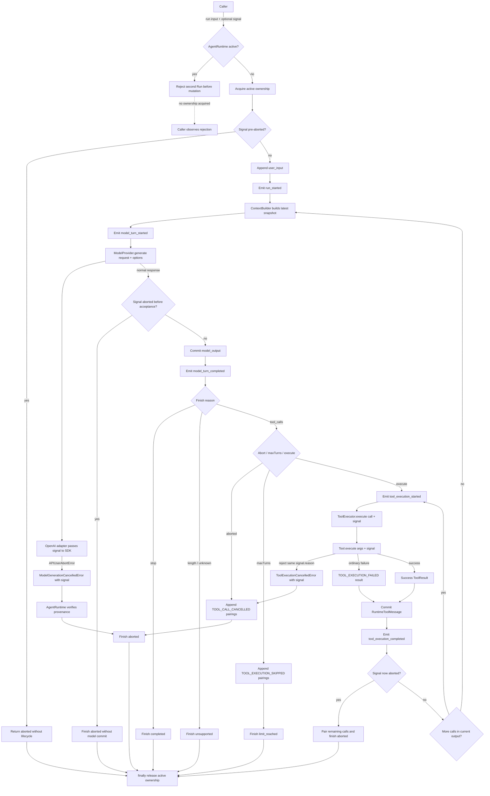

# Day08 / Part VII-F：Abort + Single Active Run

> Engineering Learning Log + Architecture Record
>
> Milestone 状态：Done
>
> 归档与代码复核日期：2026-09-22
>
> 代码基线：`a94a30c`（Abort + Single Active Run 主体实现）+ `df7dad6`（Cancellation Attribution 修复）

本文由三组证据交叉核对：

1. 当前仓库的 `src/`、`test/`、工程配置以及提交 `a94a30c`、`df7dad6`，决定最终代码事实。
2. [Part VII-F 完整学习／架构讨论](https://chatgpt.com/c/6aacda37-701c-83ee-8ba0-0cd01516a01e)，用于还原 Architecture Analysis、Design Decisions、Implementation Review、Must Fix、Theory Feedback 与 Milestone Closure。首先使用 Codex `read_thread` 确认 10 个 turn、`hasMore: false`，但其中两条长回复被单条 20,000 字符限制截断；随后从用户提供的[公开分享页](https://chatgpt.com/share/6ab0ffa7-4970-83ee-b711-fb31b963e848)下载 HTML，解码页面自带的 conversation mapping，核对 backing conversation ID 与原 ID 相同，并按当前分支完整重建 10 个 turn。上传附件仅归档名称，不声称拥有其二进制内容。
3. Codex 本轮实际实现、测试和 Debug 过程：第一轮实现通过 73 项测试，Code Review 发现 cancellation attribution race；修复后 75 项测试、build、严格测试类型检查、diff check 与两个 deterministic demo 全部通过。代码以当前仓库和两个实现提交为准，而非聊天中的示意代码。

本地完整 source 归档：[Architecture Analysis、Design Decisions 与 Implementation Task](source/day08-part-vii-f-architecture-chatgpt-source.md)（7 轮）、[首轮 Review、Must Fix、修复复核与 Closure](source/day08-part-vii-f-review-chatgpt-source.md)（3 轮）、[Codex 实现、测试与 Debug 工程证据](source/day08-part-vii-f-codex-implementation-source.md)。前两份保存公开分享页当前分支的完整非空用户／助手正文，规范化行尾空白；没有把 redacted tool output 或附件内容冒充正文。

聊天中的早期候选 API、示意代码和第一轮实现不等于最终行为。尤其是第一轮曾使用 `signal.aborted` 作为 caught failure 的唯一 cancellation 判据；最终代码已经改为显式 cancellation provenance。本文会把前者作为 Debug 过程记录，而不会把它描述成当前方案。

## 1. Milestone Goal

VII-A～VII-E 已经让 Runtime 具备类型语言、State、Agent Loop、Tool execution、Context projection 和 lifecycle observation，但还没有回答两个执行控制问题：

```text
同一个 Runtime 能否同时推进两个 Run？
正在执行的 Run 如何被 Caller 请求停止？
```

VII-F 的目标是在不重写现有 Agent Loop 的前提下，建立最小 Run Control：

```text
Caller
  │ run(input, { signal? })
  ▼
AgentRuntime
  ├─ Active Run admission
  ├─ cancellation checks
  ├──────────────→ ModelProvider
  │                    signal
  └──────────────→ ToolExecutor
                           │
                           └─→ Tool
                                signal
```

完成标准不只是“能调用 `AbortController.abort()`”，而是同时保证：

- 同一个 `AgentRuntime` 实例最多只有一个 Active Run。
- 并发／重入 Run 在任何 State mutation 和 lifecycle event 前失败。
- 同一个 `AbortSignal` 传到 Provider 和 Tool execution boundary。
- Cancellation 是 `{ type: "aborted" }`，普通 Provider／Tool failure 保持原语义。
- 已提交事实不因 Abort 回滚。
- 已提交的 ToolCall 即使取消也必须形成合法 Tool Result pairing。
- Event 只描述真实 lifecycle，不为取消伪造 completed。
- 所有 return／throw 路径都释放 Active Run ownership。

## 2. Starting Point

本轮从 VII-E 完成态继续。起点已有 60 项测试，真实职责如下：

| VII-F 前的真实状态 | 本轮承接方式 |
| --- | --- |
| `RuntimeState` 只有 `messages` | schema 不变；Active Run 和 signal 都是 process-local control state |
| `AgentRuntime` 是唯一 State mutation owner | 进一步成为 Active Run ownership 和 cancellation settlement owner |
| `run(userInput)` 立即 append user message 并发 `run_started` | 在它们之前增加 admission guard 和 pre-abort check |
| 同一 Runtime 顺序多次 run 会保留历史 | 保持；只禁止同一实例同时有两个未 settle 的 run |
| 每个 Model Turn 由 `ContextBuilder` 构建 snapshot | signal 不进入 Snapshot 或 `ModelRequest` |
| `ModelProvider.generate(request)` | 增加独立 `ModelGenerationOptions`，把 execution control 与模型语义分开 |
| `Tool.execute(args)` | 增加 optional `ToolExecutionOptions`，老 Tool 保持低摩擦兼容 |
| Tool throw 被归一化为 `TOOL_EXECUTION_FAILED` | 明确的 cooperative cancellation 必须绕过该 contract |
| Tool Calls 顺序执行 | 保持顺序；Abort 只改变后续推进和 unresolved pairing |
| `maxTurns` 写 `TOOL_EXECUTION_SKIPPED` | 保持原含义；取消与 skipped 不能重复结算同一 call |
| Event 只有六个 lifecycle 分支 | 不增加 aborted／failed 专用事件，复用 `run_finished` |
| Provider error 原对象向上传播，不发 `run_finished` | 普通错误保持；只有明确 cancellation 形成 aborted outcome |

真正的并发风险不是 JavaScript 多线程，而是两个 async loop 可以在不同 `await` 之间交错：

```text
Run A: append user A → await Provider
Run B: append user B → await Provider
Run B: append assistant B
Run A: append assistant A
```

这会让共享 `RuntimeState.messages` 不再能被解释为一条确定的 conversation history，也破坏 Context snapshot 与最终 transcript 的对应关系。

## 3. Architecture Questions

本轮先围绕 ownership、取消边界和 settlement 提问，再决定 API：

| 问题 | 关键矛盾 | 最终答案 |
| --- | --- | --- |
| F-1 Active Run 属于谁 | 当前还没有 Session entity | 属于每个 `AgentRuntime` 实例 |
| F-2 第二个 `run()` 怎么办 | 排队会引入 scheduler；覆盖旧 Run 会丢语义 | 在 mutation 前 Fail Fast |
| F-3 Subscriber 重入是否特殊 | 重入和外部并发是否需要两套 guard | 不需要；都是第二个 Active Run |
| F-4 谁拥有取消意图 | Runtime 自建 controller，还是 Caller 传 signal | Caller owns intent；Runtime consumes signal |
| F-5 Signal 放在哪里 | `ModelRequest` 是语义数据，signal 是执行控制 | 独立 generation／execution options |
| F-6 Abort 是否能强杀 Promise | JavaScript 没有通用 `Promise.kill()` | 采用 cooperative cancellation |
| F-7 Cancellation 是否是 Error | Caller 主动停止是预期 termination | Runtime settlement 为 `RunOutcome.aborted` |
| F-8 Provider response 何时成为事实 | HTTP 已返回不等于 Runtime 已接受 | acceptance 前发现 abort 可丢弃 response |
| F-9 Tool result 何时成为事实 | Tool 可能已经产生外部副作用 | 成功返回后先 commit，再因 abort 停止后续推进 |
| F-10 ToolCall 取消后如何保持协议 | assistant call 已提交但没有 result 会留下非法 transcript | 为所有 unresolved calls 写 `TOOL_CALL_CANCELLED` |
| F-11 取消 pairing 是否算执行完成 | Runtime-generated pairing 不等于 Tool 真实执行 | 不伪造 `tool_execution_completed` |
| F-12 如何区分取消与同时发生的普通错误 | `signal.aborted` 只能证明 intent，不能证明 cause | 增加明确 cancellation provenance |
| F-13 ownership 何时释放 | return／throw 分支很多，手工清理容易漏 | 外层 `try/finally` 统一释放 |

学习对话中用户曾把并发理解为“Run B 到来时 fail A”。讨论明确纠正：最终是 **B 立即失败、A 原样继续**；另一次追问把 pre-abort 类比为 UI 中未发送的草稿，澄清了“UI 可见内容不等于 Runtime committed fact”。这两处澄清直接决定了 guard 在 mutation 前，以及 pre-abort 不 append `user_input`。

## 4. Design Decisions

### 最终采用方案

1. **F-AD01：Single Active Run per `AgentRuntime` instance。** 不同实例可并行，同一实例不可并发推进共享 State。
2. **F-AD02：Concurrent Run Fail Fast。** Admission guard 位于 user message、event、Provider 和 Tool 之前。
3. **F-AD03：Reentrant Run 复用同一 guard。** 不增加 reentrancy depth 或 Subscriber 专用保护。
4. **F-AD04：Cancellation API 使用 Caller-owned `AbortSignal`。** `run(userInput, { signal? })`；没有 `runtime.abort()`。
5. **F-AD05：Signal 不进入 `ModelRequest`。** Provider 通过 `ModelGenerationOptions` 接收 execution metadata。
6. **F-AD06：Tool 收到同一个 signal。** `ToolExecutor.execute(call, options)` 继续传给 `Tool.execute(args, options)`。
7. **F-AD07：Cancellation 绕过普通 Tool Error Contract，但必须有 provenance。** 普通 throw 仍是 `TOOL_EXECUTION_FAILED`；只有当前 signal 的明确 cooperative cancellation 才向 Runtime 传播。
8. **F-AD08：Abort 是 `RunOutcome`。** 预期 termination 返回 `{ type: "aborted" }`；意外错误继续 reject。
9. **F-AD09：Pre-aborted Run 不真正启动。** 无 State、Provider、Tool 和 lifecycle event。
10. **F-AD10：Mid-run Abort 形成 `run_finished(aborted)`。** 不增加新的 Event union branch。
11. **F-AD11：Committed facts never roll back。** Abort 只阻止尚未完成的推进。
12. **F-AD12：Provider 与 Tool 采用不同 post-await semantics。** Provider response 在 acceptance 前可丢弃；成功 Tool result 必须先 commit。
13. **F-AD13：Abort 不等于 rollback。** 不撤销 Tool external effect，不实现 compensation／Saga。
14. **F-AD14：Unresolved ToolCall 写 cancellation pairing。** 使用现有 `RuntimeToolMessage` + `TOOL_CALL_CANCELLED`。
15. **F-AD15：Cancellation pairing 不伪造 Tool execution event。** started／completed 继续描述真实 execution lifecycle。
16. **F-AD16：Active ownership 永远释放。** 外层 `finally` 覆盖所有 outcome 和 exception。

最终 cancellation provenance 是 F-AD07 的必要精化：

```text
Cancellation intent
≠
Cancellation cause
≠
Runtime settlement
```

Provider cancellation 必须满足：

```text
signal.aborted
+
error instanceof ModelGenerationCancelledError
+
error.signal === currentSignal
```

Tool invocation cancellation 必须先满足：

```text
signal.aborted
+
caughtError === signal.reason
```

`ToolExecutor` 再生成携带相同 signal 的 `ToolExecutionCancelledError`，Runtime 最后验证 marker 和当前 signal identity。

### 讨论过但没有采用的方案

| 候选方案 | 未采用原因／最终处理 |
| --- | --- |
| 自动排队第二个 Run | 会引入 queue、ordering、queued cancellation 和 scheduler，超出 VII-F |
| latest-wins／自动 Abort 当前 Run | 会让新调用隐式改变旧调用 ownership，语义不透明 |
| 第二个 Run 复用当前 Promise | 新输入实际上没有执行，返回值语义错误 |
| 全局 Single Run | 不同 Runtime 实例拥有不同 State，应允许独立并行 |
| Session-level lock | Session entity 尚未出现，留给 VII-G 后再讨论跨实例 ownership |
| Subscriber 返回 cancel／stop | VII-E Subscriber 是 Observation，不是 Control |
| `runtime.abort()`／内部 `AbortController` | 会引入第二个取消来源和 signal composition；当前 Caller-owned signal 已足够 |
| `AbortSignal.any()` | 当前只有一个取消来源，没有组合需求 |
| 把 signal 放进 `ModelRequest` | 混淆模型语义输入与 invocation execution control |
| 通用 `ExecutionContext`／`ToolContext` | 当前只需要 signal；logger、session、approval、trace 都是提前抽象 |
| 看到名为 `AbortError` 就判 cancellation | 名称／消息字符串不能证明属于当前 signal |
| 第一轮 `if (signal.aborted)` 归因 | 只能证明取消意图，不能证明 caught failure 的原因；Review 后淘汰 |
| Abort 时删除 user／assistant／tool message | 破坏 committed facts 和真实外部效果记录 |
| Tool 成功返回后因 signal aborted 丢弃结果 | Tool 可能已经产生副作用，Runtime 必须诚实 commit |
| 新增 `run_aborted`／`tool_execution_aborted` | 现有 `run_finished(outcome)` 和非对称 execution events 已能表达真实语义 |
| Parallel Tools | 改变 VII-C 顺序执行契约，不属于本轮 |

## 5. Why These Decisions

### Single Active Run 保护的是 mutation authority

`#active` 不是性能优化，也不是 UI 防抖。它保护的是：

```text
一个 RuntimeState
在任意时刻
只有一个 Agent Loop 有 mutation authority
```

因此 guard 必须由 Runtime 自己维护，不能依赖调用方“不要连续点击”。Subscriber 重入测试进一步证明，竞争入口可能来自 Runtime 同步 callback，而不只是两个外部 Promise。

### Fail Fast 比隐式调度更符合 Mini Runtime

排队意味着 `run()` 可能现在执行，也可能以后执行，还要定义队列中的 Abort、顺序和失败传播。Fail Fast 则给出简单稳定的 contract：

```text
idle   → acquire → execute
active → reject immediately
```

调度不是免费的便利功能，而是一套新的 ownership system；本轮没有引入它。

### `AbortSignal` 只表达 Intent

Caller 调用 `abort()` 只说明：

```text
“我希望当前工作停止。”
```

它不保证 Provider／Tool 已经停止，也不证明随后出现的任意错误是由取消造成。真正的 cooperative cancellation 必须由正在执行的 boundary 识别并明确向上传递。

### ModelRequest 与 execution metadata 必须分层

`ModelRequest` 是 ContextBuilder 产出的模型语义输入：messages 和 optional tools。Signal 决定 HTTP invocation 是否继续，属于 execution metadata。因此最终接口是：

```ts
generate(request, { signal })
```

而不是：

```ts
request.signal
```

这保住了 VII-D 的 Context projection 边界。

### Provider adapter 应解释 provider-specific failure

OpenAI SDK 抛出的 `OpenAI.APIUserAbortError` 不应泄漏进 Runtime Core。`OpenAIModelProvider` 把它翻译成 provider-neutral `ModelGenerationCancelledError`：

```text
OpenAI-specific error
        ↓ adapter
Provider-neutral cancellation marker
        ↓ Runtime
aborted settlement
```

Runtime 只理解自己的 contract，不依赖 OpenAI SDK 类型。

### Commit boundary 决定 Abort 后保留什么

Provider 返回 response 后，Runtime 还没有接受它；此时 signal 已取消，可以不 commit。Tool 成功返回则不同：Tool 可能已经发邮件、写文件或调用外部 API，因此结果必须作为 Runtime fact 保存。

```text
Provider return ≠ accepted model fact
Tool successful return ≈ completed external operation
```

不同 `await` 具有不同业务语义，不能为了代码对称使用同一种 post-await 处理。

### ToolCall pairing 与 Tool execution event 是两套语义

`TOOL_CALL_CANCELLED` 解决 transcript protocol：每个已提交 ToolCall 都有一个 Tool Result。`tool_execution_completed` 描述真实执行：ToolExecutor 形成 final result 且 Runtime 已 commit。

所以完全允许：

```text
RuntimeState 中存在 cancellation tool_result
但没有 tool_execution_completed event
```

### `finally` 是 ownership protocol

Active Run 类似 lock、connection 或 file handle：

```text
acquire
  ↓
try execute
  ↓
finally release
```

把释放分散在每个 return branch 会让新增 outcome 或 exception 时出现永久锁死风险。

## 6. Implementation Scope

本轮只修改 Run Control 真正经过的现有边界：

```text
src/runtime/agent-runtime.ts
src/model/model-provider.ts
src/model/openai/openai-model-provider.ts
src/tools/tool.ts
src/tools/tool-executor.ts
src/tools/tool-registry.ts
test/support/mock-model-provider.ts
test/run-control.test.ts
```

没有新增 RunManager、Scheduler、CancellationManager 或通用 Context 文件。唯一新增的 source-level contract 是现有 Provider／Tool 文件中的最小 options 和 cancellation marker。

Public API 的增量是：

```ts
type RunOutcome =
  | { type: "completed" }
  | { type: "unsupported"; finishReason: "length" | "unknown" }
  | { type: "limit_reached"; maxTurns: number }
  | { type: "aborted" };

interface RunOptions {
  signal?: AbortSignal;
}

runtime.run(userInput, options?);
```

Provider contract：

```ts
interface ModelGenerationOptions {
  signal?: AbortSignal;
}

interface ModelProvider {
  generate(
    request: ModelRequest,
    options?: ModelGenerationOptions,
  ): Promise<ModelResponse>;
}
```

Tool contract：

```ts
interface ToolExecutionOptions {
  signal?: AbortSignal;
}

interface Tool<TArgs> {
  execute(
    args: TArgs,
    options?: ToolExecutionOptions,
  ): ToolValue | Promise<ToolValue>;
}
```

optional 第二参数让已有只声明 `execute(args)` 的 Tool 继续满足 structural typing，不需要无意义地接收未使用参数。

## 7. Code Changes

| 文件 | 当前真实变化与职责 |
| --- | --- |
| [runtime/agent-runtime.ts](../../src/runtime/agent-runtime.ts) | 增加 `RunOptions`、`aborted` outcome、实例级 `#active`、外层 `try/finally`、关键 transition cancellation checks、Provider／Tool marker 验证、cancelled ToolCall pairing |
| [model/model-provider.ts](../../src/model/model-provider.ts) | 增加 `ModelGenerationOptions` 和携带 signal identity／cause 的 `ModelGenerationCancelledError`；定义 adapter cancellation contract |
| [model/openai/openai-model-provider.ts](../../src/model/openai/openai-model-provider.ts) | 将 signal 传给 OpenAI SDK v5 `chat.completions.create(body, options)`；只把当前 signal 下的 `APIUserAbortError` 转换为中立 marker |
| [tools/tool.ts](../../src/tools/tool.ts) | 增加 optional `ToolExecutionOptions`；文档化 reject `signal.reason` 的 cooperative contract；增加 `TOOL_CALL_CANCELLED` code |
| [tools/tool-executor.ts](../../src/tools/tool-executor.ts) | 转发 signal；仅在 caught error 严格等于当前 `signal.reason` 时抛 `ToolExecutionCancelledError`；普通错误继续归一化 |
| [tools/tool-registry.ts](../../src/tools/tool-registry.ts) | 在异构 Registry 的参数类型擦除边界继续转发 execution options |
| [test/support/mock-model-provider.ts](../../test/support/mock-model-provider.ts) | 接受并记录 generation options，用于 signal propagation 测试 |
| [test/run-control.test.ts](../../test/run-control.test.ts) | 新增 15 项 Run Control／Cancellation regression tests；现有测试总数由 60 增至 75 |

核心 ownership wrapper：

```ts
async run(userInput: string, options: RunOptions = {}): Promise<RunOutcome> {
  if (this.#active) {
    throw new Error("AgentRuntime already has an active run.");
  }
  this.#active = true;

  try {
    return await this.#run(userInput, options.signal);
  } finally {
    this.#active = false;
  }
}
```

Provider acceptance boundary：

```ts
const response = await provider.generate(request, { signal });

if (signal.aborted) {
  return finish({ type: "aborted" });
}

// only now accept and commit model_output
```

Tool success boundary：

```text
await ToolExecutor.execute
  ↓ final result formed
serialize RuntimeToolMessage
  ↓
append tool_result
  ↓
emit tool_execution_completed
  ↓
check signal and stop future progression
```

## 8. Runtime Verification

### 新增测试保护的契约

| 测试组 | 可执行证据 |
| --- | --- |
| concurrent run | 第二个 Run 立即 reject；不写 input、不发 event、不调 Provider；第一个 Run 正常完成 |
| subscriber reentrant run | 同一个 `#active` guard 拒绝；外层 history 不被污染 |
| pre-abort | 返回 aborted；State、Provider 和 Event 都为空；ownership 释放后可再次 run |
| provider signal／response discard | Provider 收到同一对象；abort 后返回的 response 不 commit；无 model completed |
| cooperative provider cancellation | 明确 `ModelGenerationCancelledError` + matching signal 形成 aborted |
| provider race regression | signal aborted + unrelated Error 仍按原对象 reject；后续 Run 可执行 |
| abort before tool | Tool 不执行；所有 calls 写 cancelled pairing；无 Tool execution event |
| ToolExecutor propagation | Tool 收到同一 signal；cooperative rejection 传播；普通 throw 仍为 execution failed |
| tool race regression | signal aborted + unrelated Tool error 仍形成 `TOOL_EXECUTION_FAILED`，并正常 commit completed result |
| abort during tool | started 存在；cooperative cancellation 写 pairing；无 completed |
| late successful Tool abort | 成功 result 和 completed event 保留；不进入下一 Model Turn；Run aborted |
| multiple tools | A success 保留、B cancelled、C pairing 但不执行；event 顺序对应真实 execution |
| ownership release | completed、unsupported、limit、Provider throw、aborted 后都能再次 run |
| cancellation vs maxTurns | cancelled 优先，不产生同一 call 的 skipped + cancelled 双 pairing |

### 最终验证结果

| 命令 | 实际结果 |
| --- | --- |
| `npm test` | 75 pass、0 fail |
| `npm run build` | 通过，无 TypeScript 诊断 |
| 额外严格测试 TypeScript type-check | 通过，无诊断 |
| `git diff --check` | 通过 |
| `npm run demo:runtime` | 通过；两次顺序 Run completed，跨 Run history 正常 |
| `npm run demo:tools` | 通过；两 Model Turn、一次 add Tool、最终 completed |

严格测试类型检查命令：

```bash
./node_modules/.bin/tsc --noEmit \
  --target ES2022 \
  --module NodeNext \
  --moduleResolution NodeNext \
  --allowImportingTsExtensions \
  --strict \
  --noUncheckedIndexedAccess \
  --exactOptionalPropertyTypes \
  --skipLibCheck \
  test/*.test.ts test/support/*.ts
```

没有新增 npm script。现有 `test/**/*.test.ts` 和 strict type-check glob 自动包含 `run-control.test.ts`。

### 关键 settlement 序列

并发 Run：

```text
Run A active
Run B run()
  ↓ guard rejects
no state / no event / no provider
Run A continues
```

Provider cancellation：

```text
append user_input
run_started
model_turn_started
Provider receives signal
  ↓ explicit cancellation marker
run_finished(aborted)
finally release
```

Tool cancellation：

```text
append model_output(toolCalls)
model_turn_completed
tool_execution_started
Tool rejects current signal.reason
  ↓ ToolExecutionCancelledError
append TOOL_CALL_CANCELLED for unresolved calls
run_finished(aborted)
finally release
```

Late Tool abort：

```text
Tool returns success
append real tool_result
tool_execution_completed
signal is aborted
stop before next Model Turn
run_finished(aborted)
```

## 9. Bugs / Debugging

### 9.1 第一轮 73 项测试全绿，但 cancellation attribution 仍然错误

第一轮 Provider catch 和 Tool invocation catch 使用了类似逻辑：

```ts
catch (error) {
  if (signal?.aborted) {
    // treat error as cancellation
  }
}
```

它能通过正常 cancellation 测试，却没有覆盖这个竞态：

```text
Provider / Tool independently fails
+
Caller aborts at nearly the same time
```

catch 时 `signal.aborted === true` 只证明 Caller 表达了 cancellation intent，不能证明 caught error 的 cause。结果可能是：

- 普通 Provider Error 被错误吞掉并转换成 `{ type: "aborted" }`。
- 普通 Tool failure 被错误转换成 `TOOL_CALL_CANCELLED`，丢失 `TOOL_EXECUTION_FAILED` 事实。

这是第一轮 Review 唯一 Must Fix，也说明：

> 大量 happy／edge-path tests 仍可能没有覆盖两个异步事件近同时发生时的 attribution race。

### 9.2 Provider 修复：让 Adapter 提供中立来源证明

修复没有让 `AgentRuntime` 认识 OpenAI-specific error，而是在 Provider contract 中增加：

```ts
class ModelGenerationCancelledError extends Error {
  readonly signal: AbortSignal;
}
```

OpenAI adapter 只在：

```text
options.signal.aborted
+
error instanceof OpenAI.APIUserAbortError
```

时产生该 marker。Runtime 再检查 marker 类型与 signal identity。普通 Provider Error 即使在 signal 已 aborted 时到达，也保持原对象传播。

### 9.3 Tool 修复：signal state 加 reason identity

Tool contract 明确 cooperative cancellation 应 reject 当前 `signal.reason`。ToolExecutor 只在：

```ts
options.signal.aborted && error === options.signal.reason
```

时转换为 `ToolExecutionCancelledError`。因此无需比较 error name 或 message，也不会把同时发生的独立 Tool Error误归因。

### 9.4 Race regression 改变了测试关注点

修复后测试数由 73 增至 75。两个新增测试不是再次验证“Abort 能工作”，而是验证“Abort 与普通失败同时出现时不会抢走失败语义”：

```text
Provider race → original error identity
Tool race     → TOOL_EXECUTION_FAILED
```

这使测试从控制流覆盖升级为因果归因覆盖。

### 9.5 Cancellation 与 maxTurns 需要唯一 settlement

模型在最后允许的 Turn 返回 Tool Calls 时，既可能触发 maxTurns，也可能已经收到 Abort。实现把 cancellation check 放在 skipped pairing 前，因此一个 ToolCall 只会得到一种终止解释：

```text
aborted      → TOOL_CALL_CANCELLED
not aborted  → TOOL_EXECUTION_SKIPPED + limit_reached
```

如果顺序相反，Runtime 可能在已经取消时仍写 skipped，或者为同一 ToolCall 写两份 result。

### 9.6 `run_finished` 与 ownership release 不是同一瞬间

`#finish()` 会同步通知 Subscriber，然后 public `run()` 才进入 `finally`。因此 Subscriber 收到 `run_finished` 时，当前 Run 的 ownership 尚未释放；此时重入 `run()` 仍会被 guard 拒绝。

这不是 Bug，而是两个不同边界：

```text
run_finished = Runtime lifecycle 已形成 terminal outcome
run() settled = public invocation 完成并释放 resource ownership
```

## 10. Code Review Findings

最终 Review 结论：**PASS，Must Fix = 0 remaining，Part VII-F 可关闭。**

| 检查项 | 最终结论 |
| --- | --- |
| Active guard 是否在 mutation 前 | 是 |
| 并发／重入是否共享同一 invariant | 是 |
| pre-abort 是否无 lifecycle | 是 |
| signal 是否保持对象 identity 传播 | 是 |
| ModelRequest 是否被 control metadata 污染 | 否 |
| OpenAI-specific error 是否泄漏到 Runtime | 否，由 adapter 转译 |
| 普通 Provider error 是否保持 identity | 是，包括 abort race |
| 普通 Tool failure 是否仍归一化 | 是，包括 abort race |
| cancellation 是否绕过 Tool failure contract | 是，但必须有明确 provenance |
| Provider aborted response 是否在 commit 前丢弃 | 是 |
| 成功 Tool result 是否在 late abort 下保留 | 是 |
| committed facts 是否回滚 | 否 |
| unresolved ToolCalls 是否全部 pairing | 是 |
| cancellation pairing 是否伪造 completed event | 否 |
| Multiple Tool Calls 是否仍顺序执行 | 是 |
| maxTurns skipped semantics 是否回归 | 否 |
| Event union 是否膨胀 | 否 |
| 所有 settlement／throw 是否释放 ownership | 是，统一 `finally` |
| Scope expansion | 未发现 |

Review 接受但不在本轮扩展的限制：

- Abort 是 cooperative request。忽略 signal 且永久 pending 的 Provider／Tool 不能被 Runtime 强制终止。
- Tool 外部副作用与 Runtime fact commit 不是原子事务；crash window 需要 durable execution，而不是本轮 Abort 逻辑。
- 当前只保证 per-Runtime-instance Single Active Run，不保证两个 Runtime instance 指向未来同一 Session 时的跨实例互斥。

## 11. Theory Feedback

### Control 是独立于 State、Context、Observation 的第五个维度

到 VII-F，Mini Runtime 已形成：

```text
State        — 已发生什么
Execution    — Tool 怎样运行
Context      — Model 下一轮看什么
Observation  — 外部怎样看到 lifecycle
Control      — 谁可以运行，谁可以请求停止
```

Abort 不是 Event Subscriber 的附加能力，也不是 RuntimeState 中的一条 conversation fact。它属于当前进程中的 execution control。

### Cancellation 应拆成 Intent、Cause、Settlement

本轮最重要的理论升级是：

```text
AbortSignal
  → Intent：Caller 想停止

Provider／Tool cancellation marker
  → Cause：operation 确因当前 signal 终止

RunOutcome／Tool pairing
  → Settlement：Runtime 如何结束并记录
```

把三者混为一谈，就会出现第一轮 attribution bug。这个模型也可以迁移到未来的 timeout、approval denied、policy blocked 和 budget exhausted，但本轮没有提前统一抽象它们。

### Cancellation 是状态机推进，不是事务回滚

Abort 的效果是阻止未来 transition：

```text
不再开始下一 Tool
不再开始下一 Model Turn
不接受尚未 commit 的 Provider output
```

它不会删除已经 commit 的 facts，也不会撤销现实世界中的 Tool effect。

### Protocol completion 与 physical execution completion 不同

`TOOL_CALL_CANCELLED` 让 transcript 在协议上完整；它不声称 Tool 已经完成。VII-E 的 lifecycle semantics 因而保持稳定：Event 描述真实 execution，State 也可以包含 Runtime-generated settlement fact。

### Async 单线程仍需要并发控制

Node.js 单线程不等于 async operations 不会交错。只要存在 `await`，共享 State 就可能被多个 logical execution flow 交替修改。Single Active Run 保护的是逻辑并发，而不是 OS thread。

## 12. Pi Mapping

本轮只回扣仓库已有的 [Day07 Runtime Control／Event Protocol 学习记录](../day07-pi-agent-source-analysis/day07-session-04-runtime-control-events-and-human-approval.md) 和 [Mini Runtime Extraction](../day07-pi-agent-source-analysis/day07-session-05-session-reconstruction-dynamic-runtime-and-mini-runtime-extraction.md)。没有为本笔记重新检出或验证最新版 Pi 源码，因此只记录已在 Day07 笔记中确认的对应关系。

| Mini Runtime VII-F | Pi 学习记录中的相关机制 | 相同点与有意差异 |
| --- | --- | --- |
| `#active` guard | Pi `activeRun` 并发保护 | 都拒绝同一 stateful agent 的第二个主 Run；Mini 不提供 steer／follow-up 作为替代入口 |
| Caller-owned `AbortSignal` | Pi `abort()` + internal `AbortController` | 都是 cooperative cancellation；Mini 不增加 Runtime-owned controller 或 `abort()` method |
| Provider／Tool signal propagation | Pi 把 Abort 传播到 Provider、Tool、Hook | Mini 当前只有 Provider 和 Tool，无 hook／approval boundary |
| aborted outcome + `finally` release | Pi 区分 `abort()` 请求与 `waitForIdle()` 完成 | 都承认“请求取消”不等于 Run 已 settle；Mini 通过 returned Promise 和 ownership cleanup 表达 idle boundary |
| unresolved ToolCall cancellation pairing | Pi 记录强调 Tool batch／pending ToolCall 的协议完整性 | Mini 在顺序 Tool loop 中写 `TOOL_CALL_CANCELLED`；没有 parallel batch 或 pending set |
| process-local active／signal state | Pi Session recovery 不持久化 Promise、AbortController、active stack | Mini 同样不把 `#active` 或 signal 放进 RuntimeState；VII-G 只应持久化稳定 conversation facts |

Pi 给本轮的主要启发是：Single Active Run、Abort propagation 和 idle boundary 是 Runtime Control 的不同问题。Mini 没有复制 Pi 的 Steering、Follow-up Queue、internal abort API、parallel tool lifecycle 或 Harness 层。

## 13. Architecture Decisions Added

| ID | 决策 | 当前代码／测试证据 |
| --- | --- | --- |
| F-AD01 | 每个 AgentRuntime 最多一个 Active Run | `#active`；concurrent test |
| F-AD02 | 第二个 Run 在 mutation 前 Fail Fast | guard 位于 `#run()` 前；State／event／provider assertions |
| F-AD03 | Reentrant Run 使用同一 guard | Subscriber 中调用 `run()` 的 regression test |
| F-AD04 | Caller 通过 optional AbortSignal 表达 intent | `RunOptions.signal`；无 runtime abort method |
| F-AD05 | Signal 使用独立 ModelGenerationOptions | `ModelRequest` schema 不变；Provider options contract |
| F-AD06 | ToolExecutor／Tool 收到同一 signal | optional ToolExecutionOptions；identity assertion |
| F-AD07 | Cancellation 绕过普通 Tool failure，且必须有 provenance | `signal.reason` identity、两个 neutral markers、race tests |
| F-AD08 | Abort 是 RunOutcome | `RunOutcome` 增加 `aborted` |
| F-AD09 | Pre-abort 不启动 lifecycle | no state／events／provider test |
| F-AD10 | Mid-run Abort 使用 run_finished(aborted) | provider／tool event sequence tests |
| F-AD11 | 已 commit facts 不回滚 | provider／tool／multiple tool history assertions |
| F-AD12 | Provider 与 Tool post-await semantics 不同 | response discard test；late tool commit test |
| F-AD13 | Abort 不提供 rollback／compensation | 没有相关实现；successful side-effect-like result retained |
| F-AD14 | unresolved ToolCalls 写 TOOL_CALL_CANCELLED pairing | before-tool、during-tool、multiple-tool tests |
| F-AD15 | pairing 不伪造 Tool completed event | exact event sequence assertions |
| F-AD16 | 所有路径统一释放 ownership | public `run()` try／finally；outcome／error reuse tests |

## 14. Deferred Work

| 故意未实现 | 后续位置／状态 |
| --- | --- |
| SessionStore、Conversation persistence、Runtime reconstruction | Part VII-G |
| 跨 Runtime instance、同 Session 的 ownership／locking | VII-G 出现 Session identity 后再讨论 |
| `beforeToolCall`、allow／deny、Human Approval | Part VII-H |
| Durable Approval | Part VII-H 明确不做；未来独立需求 |
| Weather Agent 完整集成链路 | Part VII-I |
| Run queue、scheduler、latest-wins、cancelPrevious | Part VII v1 未计划 |
| Steering、Follow-up、pending message queues | Part VII v1 未计划 |
| Internal AbortController、`runtime.abort()`、RunHandle | 当前无多 cancellation source 需求 |
| Timeout、retry framework | 未排期；不能借 AbortSignal 顺手实现 |
| Parallel Tools | Part VII v1 当前不做 |
| Streaming／token delta／async Subscriber | Part VII v1 当前未承诺 |
| Durable Tool Execution、idempotency key、execution log | Part VII v1 范围外 |
| Compensation、Saga、transaction rollback | Part VII v1 范围外 |
| Generic ExecutionContext／ToolContext | 未排期；当前 options 只含 signal |
| runId、traceId、OpenTelemetry | 未排期 |

## 15. Final Architecture Snapshot

当前真实调用关系如下。`RuntimeState` 仍只保存 committed messages；Active ownership 和 signal 不进入 State：



按职责观察：

```text
AgentRuntime
├─ Agent Loop owner
├─ RuntimeState mutation owner
├─ lifecycle event producer
├─ Active Run ownership owner
└─ cancellation settlement owner

ModelProvider adapter
├─ provider invocation boundary
├─ signal propagation
└─ provider-specific cancellation translation

ToolExecutor
├─ lookup / validation / invocation boundary
├─ normal Tool error normalization
├─ signal propagation
└─ cooperative cancellation provenance check

RuntimeState
└─ committed conversation facts only
```

## 16. Core Knowledge Upgrade

本轮真正学到的不是“如何使用 `AbortController`”，而是如何给一个有共享状态的异步 Runtime 建立清晰控制协议。

### 从 Loop 进入 Run Ownership

VII-B 的 Runtime 会推进 Loop；VII-F 进一步规定：

```text
谁拥有推进权
第二个执行请求能否进入
异常后推进权如何释放
```

因此 `#active` 是 ownership invariant，不只是 boolean flag。

### 从 cancellation check 进入 causal attribution

第一轮实现把 state observation 当成 cause proof：

```text
signal is aborted
→ caught error must be cancellation
```

Review 迫使设计升级为：

```text
intent signal
+
boundary-specific proof
+
matching signal identity
→ cancellation settlement
```

这是一条可迁移的工程原则：并发系统中，“某状态为真”通常不能单独证明“某事件由它导致”。

### 从 Abort 进入 Commit Semantics

决定是否保留结果，不能只看 `signal.aborted`，还要看 operation 是否跨过事实接受／外部效果边界：

```text
Provider output 尚未接受 → 可以丢弃
Tool final result 已形成   → 必须 commit
```

### 从错误分类进入边界责任

谁最了解错误，谁先翻译：

```text
OpenAI adapter 解释 APIUserAbortError
ToolExecutor 解释 Tool invocation rejection
AgentRuntime 决定 Run settlement
```

Runtime Core 因而保持 provider-neutral，也不靠字符串猜测 cause。

### 从 transcript 完整进入 protocol settlement

取消不代表删除已经承诺的 ToolCall。`TOOL_CALL_CANCELLED` 让后续 Context 仍满足 assistant ToolCall／Tool Result pairing，同时 Event 继续诚实反映“Tool 是否真实执行完成”。

## 17. Next Milestone

下一阶段是 **Part VII-G：SessionStore + Conversation Recovery**。

VII-F 留给它的关键问题是：

```text
当前 active ownership 只属于一个 Runtime object。

如果 Runtime 被销毁并从持久化 Session 重建：
- 保存哪些稳定 facts？
- 不保存哪些 process-local control state？
- aborted／cancelled pairing 如何进入恢复后的 Context？
- 两个 Runtime 实例加载同一 Session 时，是否需要更高层 ownership？
```

VII-G 应建立：

```text
RuntimeState facts
    ↓ persist
SessionStore
    ↓ load
new AgentRuntime + recovered conversation
```

但不应尝试持久化或复活：

```text
Promise
AbortSignal / AbortController
active JavaScript stack
in-memory #active ownership
正在执行的 HTTP request
```

VII-F 完成的是 process-local Execution Control；VII-G 将开始处理 stable conversation persistence 与 recovery。两者必须连接，但不能混为同一种 State。
