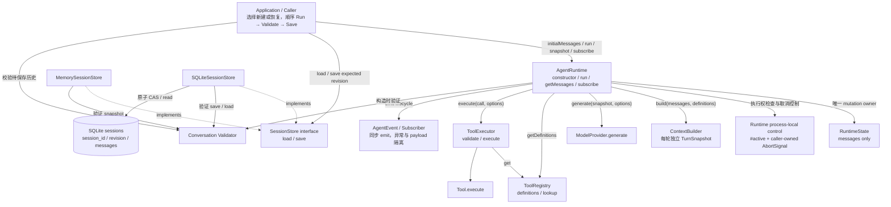

# Day08 / Part VII-G：SessionStore + Conversation Recovery

> Engineering Learning Log + Architecture Record
>
> Milestone 状态：Done
>
> 归档与代码复核日期：2026-10-10
>
> 最终代码基线：`9ec37d0 feat: add SQLite-backed conversation recovery`，包含 MF-01 的最终修复。

本文交叉核对三组证据：

1. 当前仓库源码、测试、README、package.json、package-lock.json 与 tsconfig.json，决定最终实现事实。
2. [完整 ChatGPT 学习／架构讨论](https://chatgpt.com/share/6ac9f5ba-8b58-83ee-84e7-33d63760a502)，决定设计形成过程、两轮 Review 和固定 9 项学习收尾。先尝试 `read_thread`，关联会话所在 durable host 不可用；随后读取用户指定的公开分享页 HTML，解码页面自身的 conversation mapping。从 current_node 沿 parent 重建的 146 节点与 mapping 节点集合相同，共 14 个用户 turn。没有把 bounded preview 当完整记录。
3. Codex 实施／Fix 的交付记录与实际测试日志，决定工程验证与 Debug 事实。ChatGPT 的静态 Review 不等于重新执行测试；本文也不把文档阶段的源码核对写成 Runtime 验证重跑。

完整 source：[架构分析、决策与 Implementation Task（第 1～8 轮）](source/day08-part-vii-g-architecture-chatgpt-source.md)、[交付、两轮 Review、MF-01 与固定 9 项收尾（第 9～14 轮）](source/day08-part-vii-g-review-chatgpt-source.md)、[Codex 实现、测试与 Debug 工程证据](source/day08-part-vii-g-codex-implementation-source.md)。前两份合计保存 95 条非空公开消息：14 条用户正文、43 条助手正文／分段输出、17 条公开工具请求和 21 条工具正文／redacted 占位，仅规范化行尾空白，不截断长回复。系统与私有 reasoning 不归档；附件名称不等于附件二进制。

固定 9 项学习收尾作为理论素材嵌入本笔记，固定 17 章作为工程归档结构。历史示意 API、候选方案和教学流程图不能替代真实代码依赖。

## 1. Milestone Goal

VII-F 已能在一个进程内连续对话、执行 Tool、取消 Run，并保证同一 Runtime 最多一个 Active Run。VII-G 要回答：

```text
停止使用旧 Runtime → 关闭数据库 → 重新打开数据库
                    ↓
           通过 sessionId 加载历史
                    ↓
       新建 Runtime(initialMessages) → 继续对话
```

目标是最小 Conversation Persistence & Recovery：保存已经提交且可恢复的消息，跨数据库连接恢复完整历史，用新 Runtime 继续正常 Agent Loop。Memory 与 SQLite 都必须检测旧版本写入，非法或未配对历史不得污染最后一次有效快照。

验收还包含异常边界：Provider Error 后合法 user_input 可以保存；Run Error 与 Persistence Error 分别可观察；保存失败不得自动重跑工具；pre-aborted 且无新增事实不创建或递增 Session。

恢复对象是稳定 Conversation，不是正在执行的 Promise、HTTP、Tool 或 Agent Loop。Run boundary 之间仍存在崩溃窗口，本轮不声称 Durable Execution。

## 2. Starting Point

起点是 VII-F 完成态，75 项测试通过。[VII-F 笔记](day08-part-vii-f-abort-single-active-run.md)所确立的状态和控制边界继续成立。

| 起点事实 | VII-G 承接方式 |
| --- | --- |
| RuntimeState 只有 messages | 不增加 sessionId、revision、status 或持久化控制字段 |
| AgentRuntime 是 State 唯一 mutation owner | 增加构造时历史接收，运行期间不增加第二个改写入口 |
| getMessages() 返回 structuredClone | 用于读取独立快照，外部不能借引用改写 State |
| ContextBuilder 无状态，每个 Model Turn 构建新 TurnSnapshot | 恢复历史沿原投影路径进入模型请求 |
| ToolCall / ToolResult 已有真实消息契约 | 新校验器遵循它，不添加 result.success 等字段 |
| Abort 保留已提交事实并配对 cancelled / skipped | 合法配对仍可保存，不重新解释为持久化错误 |
| #active 的外层 try/finally 释放单实例执行权 | 不扩大到 Save 阶段；Session 顺序由 Application 保证 |
| Subscriber 同步、异常隔离、payload 隔离 | 恢复不制造 lifecycle event；事件不变成持久化控制 Hook |
| Node >=20、ESM、NodeNext、严格 TypeScript | 引入兼容的 SQLite 依赖，不调整支持范围 |

先读取真实构造函数 `new AgentRuntime(provider, options)`，再扩展 Options。早期讨论中的第三个构造参数仅为示意，最终没有采用。

## 3. Architecture Questions

本轮讨论逐步从“把消息写到磁盘”收敛到三个独立边界：状态所有权、持久化提交和应用流程继续资格。

| 讨论阶段 | 真正要回答的问题 | 收敛结果 |
| --- | --- | --- |
| 第 1～2 轮：时机与所有权 | 保存每条消息，还是 Run settle 后？Runtime 是否认识 Store？ | 当前采用 Run boundary；Application 编排，Runtime 只推进 Loop |
| 第 3 轮：最小契约 | load 缺失与读取错误怎样区分？两个写入者怎么办？ | null 只表示不存在；revision CAS 显式拒绝冲突 |
| 第 4～5 轮：恢复与存储 | 构造注入还是 restore？Memory / 文件 / SQLite？异常历史能否保存？ | initialMessages；Memory + SQLite；只保存合法历史 |
| 第 6 轮：异常结算 | Run reject 后如何不丢失合法事实？Save reject 如何不遮蔽 Provider Error？ | 两份 settlement；不重跑、不回滚，顺序 Run → Save |
| 第 7 轮：边界补齐 | 业务结果内容是否解析？首存何时？非法诊断快照要不要保留？ | 仅结构／协议验证；首轮 settle 后保存；不引入诊断状态 |
| 第 8 轮：设计冻结 | 哪些是示意，哪些已经确认？ | 冻结 G-AD01～G-AD20 和实现／测试范围 |
| 第 9～10 轮：Code Review / Fix | 合法历史但保存失败，能否宣称可继续？ | MF-01：reusable 必须同时表达持久化基线是否确认 |
| 第 11～14 轮：学习收尾 | 九项学习素材如何进入整套 Part VII？ | 九项理论素材 + 十七章工程记录，不缩减章节 |

没有采用：运行中的 restore()/setMessages()、Runtime 内部持久化、逐消息 checkpoint、JSON 文件锁方案、保存不可恢复诊断快照、自动补 ToolResult、冲突合并或重试。SQLite 与 Memory 都保留，是因为一个验证真实文件持久化和原子 CAS，另一个提供确定性契约测试。

## 4. Design Decisions

最终方案形成一条明确链路：

```text
Application 明确选择“新建”或“恢复”
  → 创建 AgentRuntime，必要时注入 initialMessages
  → await Run settle，捕获原始 outcome / error
  → getMessages()，验证完整 Conversation
  → 无新增消息则 skipped；否则 await save(expected revision)
  → 分别保留 run / persistence settlement
  → 检查 reusable，成功保存后使用返回 revision 再进入下一轮
```

新会话是空历史 + expected revision 0；恢复会话必须 load 到已存在快照。恢复时 load 返回 null 或 throw 都不能默默退回空历史。Store 接口允许合法空历史保存，但 Demo 不预先创建空 Session；这是接口能力与 Application 首次保存策略的区别。

`SessionSnapshot` 保存 sessionId、revision、messages；`RuntimeState` 仍只有 messages。输入 revision 是保存前置条件，返回 revision 才是提交后的版本。正常完成、unsupported、limit_reached、aborted 和普通 reject 均走“先检查实际历史”的规则，不能仅凭 outcome 推断可恢复。

20 条冻结决策的原因、代码与验证证据逐条放在第 13 章。MF-01 修复没有增加新决策或协调器，而是纠正 G-AD12～G-AD16 在应用层的表达。

## 5. Why These Decisions

### Application-level Persistence Orchestration

执行与保存是两个结算边界。Runtime 知道消息何时提交，却不应决定 Session ID、存储实现或保存错误处理。Store 知道原子写入，却不应调用模型或 Tool。由 Caller 在两者之间编排，可以保留原始错误，同时保持 Runtime Core 不依赖 SQLite。

### Constructor-only Recovery

历史是新 Runtime 的初始化材料。构造时验证并深拷贝后，State 继续归 Runtime 独占。运行中的 restore 还需要规定 Active Run、既有事件、已执行 Tool 与替换历史之间的关系，会增加第二个状态改写入口；本轮没有这种需求。

### SQLite + Memory 与 revision CAS

真实文件持久化需要重开验证，并发保存需要数据库原子机制。SQLite 用单条条件写入满足这些目标，无需自行管理文件锁。Memory 用相同接口共享测试，避免“测试 Store”与“真实 Store”各有一套语义。revision 防止两个旧快照静默覆盖；它不阻止两个 Runtime 在保存前都调用 Tool。

### Run Boundary Persistence

先证明一次 Run 结算后的稳定事实可以保存与重建，暂不解决运行中断点、在途请求和副作用确认。逐消息 checkpoint 会引出半批 ToolCall、执行状态和崩溃恢复策略，超出 VII-G。

### 严格拒绝非法历史

单个 user_input、连续用户消息、空 model_output 和失败 ToolResult 可以合法；缺失配对则不能安全进入模型协议。删消息、造结果或重放工具都在改变或编造事实。正确行为是拒绝保存／恢复，保留内存事实，交由 Caller 显式处理。

### Dual Settlement 与继续资格

Provider throw 后已有 user_input，是事实提交而非成功回答。保存失败后 Run completed 仍然成立，但持久化尚未被确认。因此 run、persistence、reusable 分别回答“执行怎样结束”“保存怎样结束”“当前 Workflow 能否继续”，不能用一个成功／失败标签覆盖三者。

## 6. Implementation Scope

本轮的功能增量仅为一个历史校验器、构造时初始历史、两个 Store、Demo 层显式编排及对应测试。没有重写 Agent Loop，没有改变 Provider、Tool Error、Abort、ContextBuilder 或 AgentEvent Contract。

MF-01 Fix 只调整 `conversation-workflow.ts` 的继续资格、已有测试断言和 README；没有新增状态机、公共 Session 服务或执行锁。Closure 阶段只创建／更新文档，功能源码、测试、依赖和工程配置不变，也不自动提交 Git。

## 7. Code Changes

### 7.1 🔍 源码与测试定位清单

| 真实路径 | 职责／本轮变化 |
| --- | --- |
| [agent-runtime.ts](../../src/runtime/agent-runtime.ts) | Options 增加 initialMessages；构造阶段 validate + structuredClone；原 Loop 保留 |
| [runtime-state.ts](../../src/runtime/runtime-state.ts) | messages-only，不存 Session 元数据 |
| [runtime-message.ts](../../src/messages/runtime-message.ts) | 三种消息的真实 union，本轮校验依据 |
| [validate-conversation.ts](../../src/messages/validate-conversation.ts) | unknown 结构、JSON 数据与完整批次配对校验 |
| [to-model-message.ts](../../src/messages/to-model-message.ts) | 将历史事实映射成 ModelMessage，保留既有协议 |
| [context-builder.ts](../../src/runtime/context-builder.ts) | 每轮投影并隔离上下文，不读取 Store、不调用 Provider |
| [session-store.ts](../../src/session/session-store.ts) | Snapshot、Store、Conflict Error、ID／revision 校验和溢出检查 |
| [memory-session-store.ts](../../src/session/memory-session-store.ts) | 同步临界操作中的 CAS、Map 保存与双向深拷贝 |
| [sqlite-session-store.ts](../../src/session/sqlite-session-store.ts) | 文件连接、表约束、原子条件写入、JSON 读取校验、close |
| [conversation-workflow.ts](../../src/demo/conversation-workflow.ts) | runAndSave：独立 settlement、validation、skipped、reusable |
| [conversation-recovery-demo.ts](../../src/demo/conversation-recovery-demo.ts) | 两次 Run，关闭／重开 SQLite，新 Runtime 读取恢复历史 |
| [model-provider.ts](../../src/model/model-provider.ts) | 既有 generate / cancellation contract，恢复本身不调用它 |
| [tool-registry.ts](../../src/tools/tool-registry.ts)、[tool-executor.ts](../../src/tools/tool-executor.ts) | definitions / lookup / validation / execution 继续沿原路径 |
| [agent-event.ts](../../src/runtime/agent-event.ts) | 既有六种事件与同步 Subscriber，无恢复专用事件 |
| [session-store.test.ts](../../test/session-store.test.ts) | 两种 Store 复用同一组十项核心行为测试 |
| [conversation-validation.test.ts](../../test/conversation-validation.test.ts) | 合法历史、结构损坏、JSON 边界、配对错误、不改输入 |
| [runtime-recovery.test.ts](../../test/runtime-recovery.test.ts) | 构造隔离、上下文承接、无历史重放、Abort、Single Active Run |
| [sqlite-persistence.test.ts](../../test/sqlite-persistence.test.ts) | 重开恢复、独立连接 CAS、极值、损坏与操作错误 |
| [application-settlement.test.ts](../../test/application-settlement.test.ts) | 双 settlement、MF-01、pre-abort、合法／非法历史、顺序保存 |
| [conversation-fixtures.ts](../../test/support/conversation-fixtures.ts)、[mock-model-provider.ts](../../test/support/mock-model-provider.ts) | 复用真实消息契约及确定性模型测试支持 |
| [package.json](../../package.json)、[package-lock.json](../../package-lock.json)、[tsconfig.json](../../tsconfig.json) | 依赖和脚本事实、ESM / NodeNext / 严格检查依据 |
| [README.md](../../README.md) | 使用方式、错误边界、reusable 与顺序工作流说明 |

既有测试仍在仓库中：[agent-runtime](../../test/agent-runtime.test.ts)、[tools](../../test/tool-runtime.test.ts)、[context](../../test/context-builder.test.ts)、[events](../../test/agent-event.test.ts)、[run-control](../../test/run-control.test.ts)、[OpenAI mappings](../../test/openai-mappings.test.ts)。它们与新增测试一起执行，不能只据新增测试宣布 VII-F 未回归。

### 7.2 最终公共契约

```ts
interface RuntimeState {
  messages: RuntimeMessage[];
}

interface AgentRuntimeOptions {
  registry?: ToolRegistry;
  maxTurns?: number;
  initialMessages?: RuntimeMessage[];
}

interface SessionSnapshot {
  sessionId: string;
  revision: number; // save 输入：expected；load / save 返回：committed
  messages: RuntimeMessage[];
}

interface SessionStore {
  load(sessionId: string): Promise<SessionSnapshot | null>;
  save(snapshot: SessionSnapshot): Promise<SessionSnapshot>;
}
```

真实入口仍为 `new AgentRuntime(provider, options)`。`initialMessages === undefined` 时使用空数组；其他非法运行时值不能被宽松默认掩盖。构造先执行 `validateConversation(initialMessages)`，再 `structuredClone` 进入内部 State。没有 restore、setMessages 或 Store 注入。

`SessionConflictError` 公开 sessionId 和 expectedRevision；没有承诺返回实际版本。SQLite 另有 `constructor(filename: string)` 与 `close(): void`；close 不扩展最小 SessionStore 接口。Caller 负责连接生命周期。

### 7.3 校验器的真实边界

`validateConversation(messages: unknown): asserts messages is RuntimeMessage[]` 使用真实运行时检查，错误有 `kind: "structure" | "protocol"` 与路径／配对信息。

结构规则：user_input 必须有 string content；model_output 的 content、toolCalls 可缺省，存在时必须是对应类型；ToolCall 必须有非空 id、name 和 own arguments；tool_result 必须有 string toolCallId、content。ToolCall.arguments 类型仍是 unknown，只要求 JSON 数据，不在恢复时再次套用当前 Tool Schema。

JSON 检查覆盖整个消息树：普通对象／数组、有限数值、无环，拒绝 undefined、函数、BigInt、Symbol、Date / Map / 自定义原型、稀疏数组、accessor、不可枚举属性及自定义数组属性。目标是避免明显的序列化丢失，不宣称任意 JS 对象都能无损持久化。校验不改输入。

协议规则使用全局 seen IDs 与当前 batch 的 pending IDs：

- ToolCall ID 在整个历史中唯一。
- 一批 Calls 后必须连续出现该批 Results，配完前不能进入新的 user / model 消息。
- Result 只能消费该批尚未配对的 ID；拒绝孤立、重复、跨批和缺失。
- 批次内部按 ID 配对，没有额外要求 Results 与 Calls 列表位置一一顺序相等；实际 Runtime 仍顺序执行工具。
- 连续用户消息、空历史、仅 user_input、完整 cancelled / skipped / error Results 均合法。
- result.content 是不透明字符串，不要求 JSON 业务内容可解析，不检查历史 Tool 当前是否注册，不执行历史 Tool。

### 7.4 revision 与真实原子 CAS

sessionId 必须是非空白字符串；校验不把输入 trim 后当成新 ID。revision 必须是非负安全整数。0 表示“预期不存在”；成功创建返回 1。更新只能使用当前 committed revision，成功加一。MAX_SAFE_INTEGER 不能再保存，nextRevision 在写入前抛 RangeError。

Memory 在 async 方法体内同步完成验证、拷贝、版本比较和 Map 替换，中间没有 await；返回值与 load 都深拷贝。它提供单进程确定性语义，不是跨进程存储。

SQLite 使用固定 `better-sqlite3@11.10.0` 与类型依赖，schema 为 sessions(session_id, revision, messages)。session_id 唯一；revision 必须是 1～9007199254740991 的 integer。真实创建和更新为：

```sql
INSERT INTO sessions (session_id, revision, messages) VALUES (?, 1, ?)
ON CONFLICT(session_id) DO NOTHING RETURNING revision;

UPDATE sessions SET revision = revision + 1, messages = ?
WHERE session_id = ? AND revision = ? RETURNING revision;
```

每条语句本身是 SQLite 原子事务，条件比较与写入不可分割，没有先 SELECT 再无条件 UPDATE 的窗口，也没有跨 Run 的长事务。RETURNING 给出本次实际提交 revision；未返回行才归为 SessionConflictError。普通 IO、约束、关闭连接、损坏数据库等错误保持自己的语义，不统一变成 Conflict 或 null。

load 使用 safeIntegers 先取得 BigInt revision，验证范围后才转成 JS number，防止大整数舍入绕过验证；JSON.parse 后再次验证 Snapshot / Conversation。save 输入、返回结果与后续 load 相互隔离。

### 7.5 Application Workflow

runAndSave 是 Demo 层辅助函数，不是 SessionManager。返回真实类型为：

```ts
{
  run: PromiseSettledResult<RunOutcome>;
  persistence: PromiseSettledResult<SessionSnapshot> | { status: "skipped" };
  reusable: boolean;
}
```

它在 run 前校验旧历史；若旧历史已经非法，helper 直接 reject，模型／Tool 不再执行。Run settle 后验证失败则保留 run settlement，返回 persistence rejected + reusable false。合法且消息数量未增加则 skipped + true。实际保存后：

```ts
return { run, persistence, reusable: persistence.status === "fulfilled" };
```

| Run settlement | Persistence settlement | reusable |
| --- | --- | --- |
| fulfilled | fulfilled | true |
| rejected，历史合法 | fulfilled | true |
| fulfilled | rejected，包括 CAS | false |
| rejected | rejected | false |
| 任意，快照非法 | rejected | false |
| pre-aborted，合法且无新增消息 | skipped | true |

reusable 是当前 Workflow 的继续资格，不是消息是否合法的别名。它也不是内部强制锁：Caller 必须遵守 false 并显式处理，不能忽略结果继续调用。helper 不记忆之前的 save failure，不自动 reload / retry / rollback / replay；同 Session 的 Run → Save → Next Run 顺序仍是 Application 的责任。

## 8. Runtime Verification

以下是 Codex 实现／MF-01 Fix 阶段最终实际执行结果；[工程 source](source/day08-part-vii-g-codex-implementation-source.md)保存完整 Fix 测试日志。Closure 本轮只做文档与引用校验，不把历史输出改写成新测试执行。

| 命令 | 实际结果 | 证明范围 |
| --- | --- | --- |
| `npm test` | **176 pass、0 fail、0 skipped**；0 cancelled、0 todo | 原有 75 项与新增 101 项一起通过 |
| `npm run build` | 成功 | tsc -p tsconfig.json 的源码检查／构建 |
| `npm run typecheck:tests` | 成功 | strict、noUncheckedIndexedAccess、exactOptionalPropertyTypes；test/*.test.ts 与 test/support/*.ts 均覆盖 |
| `npm run demo:runtime` | 两轮 completed，第二轮基于历史回答“小明” | 既有真实 Provider 连续对话 |
| `npm run demo:tools` | add(2, 3) 得到 5，再生成最终回答 | 确定性 Model → Tool → Model |
| `npm run demo:recovery` | 首存 revision 1；关闭／重开，恢复后再存 revision 2 | 真实 SQLite 文件与新 Runtime，第二次 ModelRequest 包含恢复历史 |
| `git diff --check` | 通过 | 实现／Fix 阶段补丁空白检查 |

Recovery Demo 用实现 ModelProvider 接口的确定性 mock 对象，不使用真实 API Key；测试使用 support/MockModelProvider。数据库关闭／重开发生在同一 Demo 进程内，但换了 Store 连接与 Runtime；这证明稳定文件数据可以重建，不能写成执行中的进程恢复测试。Demo 最后清理临时数据库，不是长期 Session 管理 UI。

最有价值的验证是：独立 SQLite 连接同读旧 revision，第一个保存成功，第二个 Conflict，最终历史不被覆盖；损坏 JSON / revision 不能返回 null；Run × Save 四组合保留错误 identity；completed 但未配对历史仍拒绝保存；恢复只执行新 Calls；恢复后 Abort 与 Single Active Run 继续成立。

实际执行环境为 Node 22。Node >=20 的声明未改变，但 **Node 20 尚未独立运行安装／测试兼容性验证**。ChatGPT 依据上传源码和交付日志做静态 Review，没有在独立环境执行 npm ci / npm test。原生 SQLite 依赖的跨平台安装也不由本轮测试全面证明。

## 9. Bugs / Debugging

### 9.1 MF-01 的真实发生过程

Bug 位于 `src/demo/conversation-workflow.ts` 保存结算后的返回值。首轮代码已分别捕获 Run 和 Save，也能检测非法历史，但 save try/catch 后无条件返回：

```ts
return { run, persistence, reusable: true };
```

因此 completed + disk error、Provider Error + Save Error、CAS Conflict 都可能返回 reusable true。已保存 Session 未被覆盖，内存历史也仍合法，但调用方会得到错误的“当前流程可以继续”信号。

首轮 176 项测试为什么全部通过？因为对应测试同样接受保存失败后 true；覆盖了错误 identity、事实不回滚和冲突不覆盖，却没有正确断言 Workflow Continuability。测试绿色证明当时断言成立，架构语义仍需 Review。

ChatGPT Review #1 以“两个 Runtime 从同一旧版本运行，第二个保存 Conflict”的场景发现问题：CAS 已经否决了当前写入基线，却被 helper 表达为可继续 Run → Save。错误发生在应用编排层，不能通过修改 RuntimeState 或扩大 #active 来修复。

### 9.2 最小范围修复与回归

Codex 将最终返回值改为：

```ts
return { run, persistence, reusable: persistence.status === "fulfilled" };
```

非法 snapshot 分支仍为 false；合法无新增消息 skipped 仍为 true。Run reject 但历史保存成功仍为 true。run / persistence 对象及其 reason identity 保留；没有自动恢复、加载、重试、回滚或再执行 Provider / Tool。

[application-settlement.test.ts](../../test/application-settlement.test.ts)修改已有断言：

- 四组合矩阵用 `!saveFails` 检查 reusable；Provider / Save Error 原对象不变，调用各一次，消息不回滚。
- CAS case 增加 false 的明确断言；已保存历史不变，Provider 两个 Model Turn、Tool 一次，无自动重跑。
- pre-aborted 新／旧 Session 均明确 true + skipped，不创建／递增 revision。
- 非法历史原有 false 与下一次 run 前拒绝继续的断言保留。

修复后的测试总数仍为 176。ChatGPT 学习总结泛称“新增回归断言”，这里按实际 diff 区分：主要是修改／补充已有用例的断言，没有增加测试总数。Review #2 判定 MF-01 已修复，Must Fix 0。

### 9.3 其他有证据的工程排查

实施期间补充 symbol、accessor、自定义数组属性覆盖，避免 JSON 静默忽略数据；又补充 completed + unresolved ToolCall 用例，证明 Run outcome 不能代替恢复校验。这是覆盖完善，不虚构为先出现线上故障。

Fix 编辑脚本曾因缺少 UTF-8 声明报 Python 编码 SyntaxError，当次改动未应用；补声明、重新编辑并检查后再运行验证。它是工具脚本问题，不是 Agent Runtime Bug。

源码检查也确认：已有 Runtime 在提交 model_output 后可能遇到普通异常，留下未配对 Calls。VII-G 在边界拒绝保存／复用；没有删消息或补造结果来掩盖既有行为。这是已接受的错误恢复边界，不是本轮擅自改 Loop 的理由。

## 10. Code Review Findings

Review #1 的主体架构 PASS：Runtime / Store 解耦、messages-only、原子 CAS、严格恢复校验、双 Settlement、无执行重放均符合设计。唯一 Must Fix 是 MF-01。Review #2 确认最小修复后无 Must Fix、未发现 Scope Expansion，进入学习收尾。

保留的建议与限制：helper 不是并发控制器，Application 必须顺序 await；校验器防御较严格但仍是局部小模块；Conflict Error 只带 expected revision 是可接受最小设计，不能为了展示“actual”引入一次不稳定的额外读取。同步 SQLite、线性历史、无列表／删除、无执行恢复都在已确认范围内。

本轮必须显式处理三类材料差异：

1. **教学图与代码依赖不同**：聊天部分图画了 ContextBuilder → ModelProvider、Store → Runtime 的逻辑恢复箭头。真实代码由 Runtime 分别调用 ContextBuilder 和 Provider；Application 分别调用 Store 与 Runtime。本笔记第 15 章按实际依赖绘制，source 保留原图作为历史材料。
2. **早期候选接口不同**：save 曾为 Promise<void>，Snapshot 曾未含 revision；构造参数也有示意写法。加入 CAS 后 save 返回新 Snapshot；最终只扩展现有 Options。第 5 轮 `snapshot?.messages ?? []` 的通用示例不能用于“必须恢复已有会话”的入口；最终 Demo 明确 null 即 throw，满足 G-AD18。
3. **交付包与报告不一致**：ChatGPT 实际检查的两份 Review ZIP 没有 README / package-lock.json，第二份亦缺 SHA256SUMS，尽管 Codex Fix 报告提及完整包。当前仓库这两个文件存在并已读取，Closure 可以核对最终真实文件，但不能追认 ChatGPT 曾审查缺失材料。

旧上传附件二进制本次未重新取得；工具检查的 redacted 输出不可还原。它们不妨碍当前源码闭环，但构成历史交付材料的证据边界。

## 11. Theory Feedback

| 本轮认知升级 | 代码中的具体含义 |
| --- | --- |
| Session ≠ Runtime | Session 是可持久化历史与 revision；Runtime 是推进 Loop 的进程内对象，State 仍只有 messages |
| Conversation Recovery ≠ Execution Recovery | initialMessages 初始化新 Runtime，不恢复旧 Promise、栈、HTTP 或 Tool |
| Runtime Commit ≠ Persistence Commit | user_input 已进入 State，Provider 可仍失败；数据库未必已保存 |
| CAS ≠ Execution Lock | CAS 在保存边界拒绝旧版本；保存前两实例仍可都产生副作用 |
| Conversation Validity ≠ Workflow Continuability | 合法消息 + Save Conflict，验证通过但 reusable false |
| Recovery ≠ Tool Replay | 历史 Result 作为上下文事实，不再触发对应工具 |
| Run Settlement ≠ Persistence Settlement | completed / 原始 Error 与 save fulfilled / 原始 Error 独立保留 |

MF-01 把原先混在一起的“消息合法”和“可以继续”拆开了。持有 revision 5 的副本只是提交条件，不是执行权；保存成功也只是持久化提交，不把 Provider Error 变成 completed。

另一个重要边界是崩溃窗口：Tool 已发券，SQLite 尚未保存，进程就退出。磁盘里缺少记录无法证明发券没发生；Conversation Recovery 不能通过自动重放来解决。需要副作用幂等、执行日志与确认协议，但这些留到 v1 之后。

普通 Persistence Error 也不能笼统解释为“数据库必定完全没写”。当前 CAS Conflict 和验证拒绝有明确不覆盖保证；一般保存失败表示提交没有被 Caller 确认，调用方必须显式处理，不能随意换 revision 后覆盖或自动重跑业务。

## 12. Pi Mapping

Pi 对照只取自既有 [Day07 Session Reconstruction / Dynamic Runtime 源码学习](../day07-pi-agent-source-analysis/day07-session-05-session-reconstruction-dynamic-runtime-and-mini-runtime-extraction.md)，不把 Mini 实现标成 Pi 官方机制，也不基于当前 Pi 新版本补推断。

| Day07 已确认机制 | VII-G 对应认识 | 必须保留的差异 |
| --- | --- | --- |
| Runtime State 与 Persistent State 分离，Promise / AbortController / activeRun 等为进程内控制 | 只保存稳定消息，不保存 #active / signal / Provider 连接 | Mini Snapshot 不复制 Pi 的配置、Session Entry 体系 |
| Pi 通过 SessionManager 将 Session entries 追加为 JSONL | 稳定 Conversation 可以持久化 | Mini 用 Memory / SQLite 全量快照与 revision CAS；不能说 Pi 使用本轮 SQLite |
| buildSessionPath 沿 parentId 回溯，再投影上下文 | 恢复材料需要重建为模型可用历史 | Pi 是 Session Tree / branch；Mini 是完整线性 messages |
| AgentEvent → AgentSession / Harness → committed boundary（如 message_end）→ append | 执行与持久化可由不同责任模块衔接 | Mini 选择 Run settle 后 Application 保存，不是事件逐消息落盘 |
| Session context 重建后建立新的 Agent / runtime 环境 | 恢复 Conversation 后创建可运行对象 | Mini 专门提供 constructor initialMessages；不是声称 Pi 有同名构造接口 |

Day07 的 Mini 提取草图曾出现 RuntimeState.status、append 型 Store、AgentFacade 持 Store。这些是早期学习草图，不是已确认 Pi 机制，也不是 VII-G 最终契约。此处以后续冻结的 messages-only、load/save、Application orchestration 为准。

没有充分证据证明 Pi 采用本轮 revision CAS、reusable 或双 Settlement 返回对象，故不做这样的对照。

## 13. Architecture Decisions Added

以第 8 轮冻结表的**决策内容**为权威，编号用于追踪。早期讨论曾有候选编号歧义，不能覆盖最终冻结。下表同时保留决策、形成原因与真实落地证据。

| ID | 最终决策 | 形成原因 | 代码／测试证据 |
| --- | --- | --- | --- |
| G-AD01 | Run Boundary Persistence，不恢复执行中 Run | 先建立稳定事实闭环，避免引入半执行 checkpoint | runAndSave 在 await run 后取快照；Recovery Demo 重建新对象 |
| G-AD02 | Application owns persistence orchestration | Run 与存储不同责任／失败边界 | AgentRuntime 无 Store 依赖；Store 无 Runtime 依赖；Demo 分别调用 |
| G-AD03 | 最小 load / save 接口 | 当前需求只是保存和读取历史 | session-store.ts；没有 list / delete / Session tree |
| G-AD04 | Snapshot 含 sessionId、revision、messages | 外部标识／写入前置条件与 Conversation 同载 | SessionSnapshot interface；State 类型不变 |
| G-AD05 | 缺失返回 null，读取失败抛错 | 不把损坏／IO 错误误当新会话 | SQLite load；损坏 JSON / schema / 文件测试 |
| G-AD06 | revision CAS 防止静默覆盖，不是执行锁 | 两 Runtime 可同读旧版本，写入必须可检测冲突 | Memory compare + set；SQLite 条件语句；双连接测试 |
| G-AD07 | constructor initialMessages 恢复 | 初始化后继续唯一 State mutation owner | Runtime 构造校验／深拷贝；无 replay / Provider / event 的恢复测试 |
| G-AD08 | 0 预期不存在，创建 1，更新 +1 | 前置版本由 Caller 提供，已提交版本由 Store 生成 | nextRevision、唯一 ID、极值／溢出测试 |
| G-AD09 | SQLite + Memory | 真实持久化／数据库原子性与确定性测试兼顾 | 两实现共享 SessionStore；重开文件与 contract tests |
| G-AD10 | Run settle 后验证并保存合法历史 | completed 与可恢复性不同，reject 后也可能有事实 | application matrix、cancelled、completed-unpaired 测试 |
| G-AD11 | 严格恢复协议，不自动修复 | 字段正确仍可能未配对；补写会伪造事实 | validateConversation；missing / duplicate / wrong-batch 拒绝 |
| G-AD12 | 独立 Run / Persistence Settlement | 保存不能改变 Run 语义 | 两 PromiseSettledResult；保存失败 reusable false |
| G-AD13 | 双重失败保留原始 Run Error | finally 中保存 throw 会遮蔽 Provider Error | 四组合 reason identity 断言，两个 catch 分开 |
| G-AD14 | CAS Conflict 显式失败，不覆盖／合并／重试 | 不绕过版本前置条件，不重复副作用 | SessionConflictError；原 Session 不变、Provider / Tool 不重跑 |
| G-AD15 | Application 顺序 Run → Save → Next Run | #active 只管 Runtime 执行，不能冒充持久化工作流锁 | helper await save；blocked-save 顺序调用测试；无全局锁 |
| G-AD16 | 非法当前历史停止复用 | 不能让不完整事实再次进入 Model context | helper run 前 validate；非法历史第二次调用拒绝、calls 不增 |
| G-AD17 | 只验结构与配对，不解析 Result 业务内容 | Runtime Tool Error / cancelled / skipped 都是合法事实 | content string 校验；非 JSON content 与错误 Result 合法测试 |
| G-AD18 | 首轮 settle 后首次保存，新建／恢复明确分开 | 不创建无意义空 Session，不把恢复失败静默降级 | Demo 新建 expected 0；load null throw；pre-aborted skipped |
| G-AD19 | 两 Store 相同契约／校验／引用隔离 | 避免测试替身与文件实现语义分叉 | 同一 cases × memory/sqlite；统一验证与 Conflict Error |
| G-AD20 | 非法快照不得覆盖最后有效版本 | SessionSnapshot 只承载可恢复历史，不承载诊断状态 | save 前 validate；非法覆盖拒绝后原 Snapshot 相等 |

MF-01 是已确认应用层语义的实施修正，不新增 G-AD21。所有决策均未要求自动保存失败恢复；明确报告并由 Caller 决定后续。

## 14. Deferred Work

| 归属 | 有意未实现的能力 |
| --- | --- |
| VII-H（Next） | beforeToolCall + 简单 Human Approval；下一阶段才讨论 Hook Contract、拒绝如何回流，不实现 Durable Approval |
| VII-I（Planned） | Weather Agent 完整链路，集成 A～H；本轮未做天气业务 |
| Part VII v1 之后 | Durable Tool Execution、Durable Approval、Session Tree、Compaction、跨实例执行协调；不增设 VII-J～VII-M |
| 当前验证限制 | Node 20 独立安装／测试兼容性；原生 SQLite 跨平台；ChatGPT 独立环境运行未发生；历史附件材料缺口 |

工业级对照用于理解差距，不是待补 VII-G 功能清单：

| 当前 Mini Runtime | 工业系统可能需要 | 为什么延期 |
| --- | --- | --- |
| 本地 SQLite / Memory 全量历史 | 多租户存储、备份、权限、审计 | 本轮验证状态边界，不建设平台 |
| CAS 冲突拒绝 | 业务冲突治理、人工协调、告警 | 自动合并会改变事实语义 |
| Conversation Recovery | checkpoint、执行日志、副作用确认 | 需要 Durable Execution 设计 |
| 单实例 #active | 跨实例 lease / execution ownership | CAS 无法防工具重复执行，本轮明确排除 |
| 历史 ToolResult 不重放 | 幂等键、外部效果核对 | 消息缺失不能证明业务未发生 |
| 线性 messages | 分支、裁剪、Summary、归档治理 | Session Tree / Compaction 在 v1 之后 |
| 同步 lifecycle events | Trace、诊断与运营观测 | 不增加 Telemetry Framework |

## 15. Final Architecture Snapshot

下面实线为真实调用／状态操作，虚线为接口实现关系。ContextBuilder 不调用 Provider，Store 不注入或调用 Runtime；历史搬运发生在 Application 的两次调用之间。



Application 先 await load，明确检查 Session 存在，再把 messages 交给新 Runtime；Store 只返回数据。Runtime 自己读取 State，调用 ContextBuilder 获得 Snapshot，然后调用 Provider。工具执行完成后也是 Runtime append Result；Store 无法修改 RuntimeState。

VII-A～VII-G 的知识地图：A 提供类型与 Provider 边界；B 定义 messages-only State 与 Loop；C 执行工具并归一化错误；D 投影每轮上下文；E 观察生命周期；F 管理取消和单实例执行权；G 保存／重建稳定历史并检测持久化冲突。它们没有被一个新 SessionManager 包起来。

## 16. Core Knowledge Upgrade

### 16.1 固定 9 项学习收尾的完整落位

九项内容完整保留在 ChatGPT source 第 13 轮。这里保留工程可迁移的内容，并标明在 17 章中的位置；九项没有替代一级章节。

| ChatGPT 固定项 | 本笔记落位 |
| --- | --- |
| 1. 学习计划与完成情况 | 第 1、2、8、17 章：目标、起点、实测与 G Done / H Next |
| 2. 《从零实现 Agent Runtime》写书 TODO | 本章 16.2：章节素材与三个工程案例 |
| 3. 学习素材与工程证据 | 第 7～10 章及三份 source：真实路径、日志、Debug、Review |
| 4. 认知升级：从 Runtime State 到可恢复的 Agent | 第 11 章：七组不能混淆的边界 |
| 5. 工业级实现对照 | 第 14 章：差距与归属，不扩 Scope |
| 6. 知识地图：VII-A～VII-G 的完整架构 | 第 15 章：真实依赖图与七个 Milestone 职责 |
| 7. 面试视角：如何证明自己理解 Agent Runtime | 本章 16.3：六个具体解释问题 |
| 8. 思考题 | 本章 16.4：五个异常／副作用场景 |
| 9. Pending 回收与下一阶段衔接 | 第 14、17 章：关闭 G 问题，保留 H / I 与 v1 之后的边界 |

### 16.2 写书 TODO：从实现事实形成章节

《从零实现 Agent Runtime》的 Session 章节可以按以下顺序展开：

1. 为什么进程内 RuntimeState 不能直接跨进程保留。
2. Session、Conversation、RuntimeState 的三个含义。
3. Application / Runtime / Store 的职责与所有权。
4. Snapshot 的最小数据契约，load null 与 throw 的区别。
5. Memory / SQLite 与 expected revision CAS。
6. constructor recovery 与既有 ContextBuilder 路径复用。
7. 结构正确为什么还需要 Conversation 协议验证。
8. Run / Persistence 双 Settlement 与 error identity。
9. Review 如何发现 reusable 的架构错误，为什么绿色测试不足。
10. Tool 副作用与保存之间的崩溃窗口，Durable Execution 的边界。

三个应保留的书稿案例：第一轮“我叫小明”落盘、重开后仍能回答姓名；两个 writer 同读 revision 3，第一个变成 4，第二个明确 Conflict；Run completed 但 Save failed，执行结果不变，Workflow 不能自动继续。每个案例都能落到本仓库测试或 Demo，而不是抽象原则。

### 16.3 面试视角：六个可解释的问题

| 问题 | 工程回答要点 |
| --- | --- |
| Agent 如何恢复对话？ | load → validation → 新 Runtime(initialMessages)；下次 run 沿原 ContextBuilder 路径使用历史 |
| 为什么 Store 不放在 Runtime 内？ | 状态执行与持久化编排不同职责，失败必须独立可观察 |
| 两 Runtime 并发时 CAS 能保证什么？ | 保存不静默覆盖，不能保证 Tool 只执行一次 |
| Provider 失败为何仍保存 user_input？ | 输入已是 Runtime committed fact；只要历史合法就可持久化，Run Error 不变 |
| 非法历史为什么不自动补结果？ | 不知道真实效果，补写／重放可能伪造事实或重复副作用 |
| 本轮真正发现了什么 Bug？ | MF-01 混淆合法历史与继续资格；最小修复位于 Application，未动 Loop |

### 16.4 思考题：用场景检查边界

1. **Tool 已发券，保存前进程崩溃，恢复后能再发一次吗？** 不能凭数据库没有 Result 推断发券未发生；VII-G 不重放，后续需业务幂等和效果确认。
2. **Run completed，但 CAS Conflict，应该改成 aborted 吗？** 不应。分别报告 completed 与 Conflict，reusable false，由 Caller 处理。
3. **Provider Error 只留下 user_input，应该删掉它吗？** 不删。它是合法事实，可保存；保留原始 Run Error。
4. **CAS 已原子，为什么 Tool 还会重复？** 原子边界在保存时，两个 Runtime 都可能在此之前调用外部系统。
5. **为什么 #active / AbortSignal / Promise 不写到 SQLite？** 它们属于当前进程的执行控制，序列化消息无法恢复等待点与真实网络状态。

本轮核心升级是能够沿“事实 → 提交 → 继续资格”判断问题：消息已进入 State、历史可恢复、保存已确认、当前流程可继续，是四个不同判断。MF-01 说明代码评审必须检查它们之间的转换，不能只清点功能和测试数量。

## 17. Next Milestone

VII-G 的 Implementation、Runtime Verification、Must Fix 修复与最终静态 Review 已闭环；本笔记完成工程学习归档，README 状态为 **VII-G Done、VII-H Next、VII-I Planned**。

下一阶段仅进入 **VII-H：beforeToolCall + 简单 Human Approval**。需要在下一次 Architecture Analysis 明确 Tool 前控制 Hook、允许／拒绝与消息配对的契约，不在本文预先确定接口或执行顺序；Approval 不由 Subscriber 偷渡实现，也不引入 Durable Approval。

VII-I 再完成 Weather Agent 集成。Durable Tool Execution、Durable Approval、Session Tree、Compaction、跨实例执行协调留到 Part VII v1 之后。Node 20 独立验证与历史附件交付缺口作为限制保留，不扩展成新的 Milestone。
