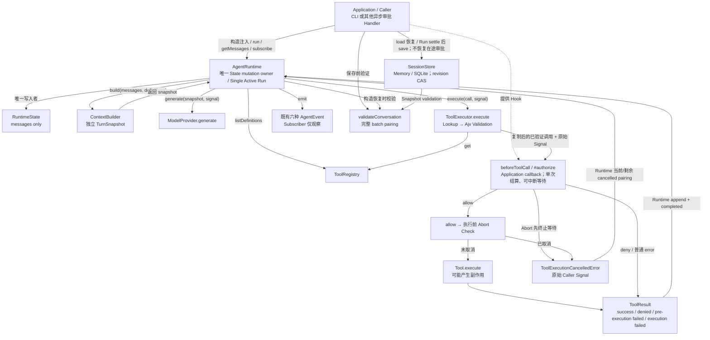

# Day08 / Part VII-H：beforeToolCall + Simple Human Approval

> Engineering Learning Log + Architecture Record
>
> Milestone 状态：Done；ChatGPT Code Review：PASS；Must Fix：0。
>
> 归档与工作区复核日期：2026-10-15。
>
> 实现代码基线：`600e7efce982dc7b3f19713cbe55fa42d118ccf2`（`feat: add pre-execution tool approval hook`）；承接 VII-G Closure 基线 `5929257`，其功能基线为 `9ec37d0`。

本文按“真实源码与测试 → 实际运行日志 → 最终确认决策 → 历史讨论”的顺序核对证据。文档归档没有重跑 Runtime 测试，也没有修改功能源码、测试、依赖或工程配置；历史实测不能写成本次 Closure 新执行。

完整材料分为三份：

- [架构分析、候选决策、Design Decision Review 与 Implementation Task（第 1～8 轮）](source/day08-part-vii-h-architecture-chatgpt-source.md)。
- [Codex 交付、ChatGPT Code Review、九项学习收尾与 Closure Task（第 9～10 轮）](source/day08-part-vii-h-review-chatgpt-source.md)。
- [Codex 实现、实际验证日志与 Debug 工程证据](source/day08-part-vii-h-codex-implementation-source.md)。

[用户提供的公开会话](https://chatgpt.com/share/6ad02e16-5f24-83ec-9e49-11cf8b5e6451)已取得完整当前分支：196 个 mapping 节点，沿 current_node / parent 重建同样 196 个节点，节点集合一致，10 个 user turn。两份 ChatGPT source 合计保存 137 条非空公开消息：10 user、34 assistant text、44 assistant code 工具请求、49 tool text。原始分段与完整回复中的重复保留，没有用摘要替代逐轮正文。

读取先尝试 `read_thread`，durable host 不可用；web open 返回 Cache miss，随后解析指定公开分享页 HTML 自带的 conversation mapping。没有读取认证信息或网页私有接口。49 条公开工具输出均为 redacted 占位，不能据此还原检查日志；历史附件仅有名称，未重新取得 ZIP / Markdown 附件二进制。实现阶段实际命令日志来自本 Codex 会话保留的工具返回值，独立于这些 redacted 占位。ChatGPT Review 明确是静态审查，没有独立执行 npm install / npm test。

## 1. Milestone Goal

在 VII-G 已完成的 Model → Tool → Model、取消、事件和历史恢复链路上，增加一个可靠的执行前授权边界：模型可以提出 ToolCall，Application 可以允许、拒绝，或异步等待人工决定，Executor 必须落实最终决策。

```text
模型提出 ToolCall
  → Runtime 记录 model_output
  → Executor：Registry Lookup → Ajv Validation → beforeToolCall
      allow → 再检查 Abort → Tool.execute
      deny / Hook Error → 失败 ToolResult
      Approval wait Abort → 原有取消异常 → Runtime 补齐 cancelled
  → Runtime 提交 tool_result
  → 下一 Model Turn 观察实际结果
```

本轮验证的不只是“有一个确认输入框”，还包括：未知工具与非法参数不触发审批；授权失败不能默认执行；Hook 不能通过引用改写已提交或实际执行的数据；审批永久 pending 也能被 Caller Abort 中断；迟到批准不能启动副作用；每批 ToolCall 仍完整配对，可以继续模型循环并保存恢复。

这是 Non-Durable Human Approval。Runtime 不提供审批 UI、审批服务、审批任务持久化、默认审批超时或跨进程 Resume。

## 2. Starting Point

[Part VII-G 最终学习记录](day08-part-vii-g-session-store-conversation-recovery.md)确立了 **176 项测试**的基线。VII-H 没有重做 VII-A～VII-G，而是在现有 Executor 边界增加门禁。

| 已有真实契约 | VII-H 如何承接 |
| --- | --- |
| AgentRuntime 是 RuntimeState 唯一 mutation owner | Hook 不取得 State，只接收复制后的 ToolCall |
| RuntimeState 仅有 messages | 不增加 approvalStatus、status、Promise 或 Handler |
| Executor owns Lookup / Ajv Validation / Tool.execute | Hook 放在同一执行链，不向 Runtime 复制 Validation |
| ToolResult 是 success / error 联合类型 | 只增加两个 ToolError code，不增加消息类型 |
| 六种 AgentEvent，Subscriber 只观察 | 不将同步 Subscriber 改为异步审批通道 |
| Caller owns 原始 AbortSignal，取消具有归因 | Hook 接收同一个 Signal；沿用 ToolExecutionCancelledError |
| #appendCancelledToolCalls() 配对未完成批次 | 审批取消同样走当前及剩余调用配对 |
| SessionStore 在 Run boundary 保存，不恢复执行中的 Run | 只保存已结算的消息，不保存等待中的批准 |
| validateConversation() 强制完整 batch pairing | deny/error/cancelled 都必须产生现有 tool_result |
| runAndSave() 分开保留 Run / Persistence Settlement 与 reusable | 审批结果不改变 CAS、Save Error 或继续资格语义 |

工具参数仍为 unknown；Tool 作者用 JSON Schema 描述执行输入。ESM、NodeNext、strict、noUncheckedIndexedAccess、exactOptionalPropertyTypes 和 Node >=20 声明保持不变。实测 Node 为 v22.18.0；Node 20 尚未独立验证。

Closure 对 `5929257 → 600e7ef` 的 Git diff 复核确认：既有测试文件没有改动；新增三份测试；package.json 仅增加 demo:approval；package-lock.json 与 tsconfig.json 未变化。因此“没有新增第三方依赖、没有改写旧测试预期”有仓库差异证据，而不只是交付描述。

## 3. Architecture Questions

第 1 轮提出 H-Q01～H-Q06，后续按依赖逐项确认。早期个别小节把“校验前后的位置”单列为 H-Q02；正式问题表把它纳入 Hook 所有权／契约。这里保留主题与讨论顺序，不据小节措辞重造问题编号。

| 问题 | 讨论中的选择 | 最终收敛及形成过程 |
| --- | --- | --- |
| H-Q01：Hook 所有权与位置 | Runtime 外层包装、Approval 专用机制、Executor 通用门禁 | 第 2 轮比较，第 3 轮用户选择通用 Hook；Executor 掌握最后执行入口，Application 提供决策 |
| H-Q02：Hook Contract | 校验前后、可否异步、能否改参数 | 已找到 Tool 且校验成功才进入；支持同步或 Promise；复制输入，返回值不能替换调用 |
| H-Q03：Approval 决策 | A1：allow/deny/requireApproval；A2：异步等待后 allow/deny | 第 4 轮确认 A2，等待由 Application Handler 实现，Core 不增加审批协调器 |
| H-Q04：Result Contract | deny 是否 Abort；Hook Error 原样 reject 还是转结果 | 第 5 轮确认方案 A：普通 Hook Error 转安全失败 ToolResult；拒绝只拒绝当前调用 |
| H-Q05：Abort × Approval | 只依赖 Hook 自行检查 Signal，或 Executor 保证等待可中断 | 第 6 轮确认方案 B：Executor 负责中断，Hook 同时收到原始 Signal；保留 VII-F 归因 |
| H-Q06：Event × Session 与注入隔离 | 新审批事件／状态、RunOptions Hook、持久 pending Approval | 第 6～7 轮收敛：构造注入；事件和 Session 不变；Hook 只返回最终决策 |

第 2～6 轮累计形成 **H-AD01～H-AD26 候选**。第 7 轮明确不覆盖旧编号，而是去重为 **H-DD01～H-DD10**；第 8 轮输出冻结实现任务和 H-T01～H-T33 验收矩阵。第 9 轮审查交付，第 10 轮完成九项学习收尾并要求归档。原文均保留在对应 source 的 Turn 标题下。

没有采用的早期例子包括 requireApproval 第三决策、TOOL_APPROVAL_DENIED 候选名称、由 Hook 返回新 ToolCall、增加 approval_requested/resolved、RuntimeState.waiting_approval、恢复 pending Promise。它们只能作为替代方案理解，不能出现在最终架构快照中。

## 4. Design Decisions

最终公共契约在 [before-tool-call.ts](../../src/tools/before-tool-call.ts)；实现保持 `new AgentRuntime(provider, options)` 和 `new ToolExecutor(registry)` 兼容。

```ts
export type BeforeToolCallDecision =
  | Readonly<{ type: "allow" }>
  | Readonly<{ type: "deny" }>;

export interface BeforeToolCallContext {
  readonly toolCall: Readonly<ToolCall>;
  readonly signal?: AbortSignal;
}

export type BeforeToolCallHook = (
  context: BeforeToolCallContext,
) => BeforeToolCallDecision | Promise<BeforeToolCallDecision>;
```

AgentRuntimeOptions 和 ToolExecutorOptions 各增加一个可选 beforeToolCall。Hook 在构造时保存，不支持 RunOptions 覆盖或运行中替换。无 Hook 时不引入审批等待；Tool 正常执行及原错误处理仍保留。Executor 还在真正调用 Tool 前检查已观察到的取消。

| 授权路径 | Tool 是否调用 | 当前调用的最终事实 | Run 如何继续 |
| --- | --- | --- | --- |
| allow 且执行前未取消 | 是 | Tool 原有 success / execution failure | 按既有 Loop |
| deny 先被接受 | 否 | TOOL_EXECUTION_DENIED | 结果可回流模型；后续若 Abort 则结束 Run |
| 普通 Hook Error / 非法值先被接受 | 否 | TOOL_PRE_EXECUTION_FAILED | 同上，错误原文不回流 |
| Abort 先终止等待 | 否 | 当前及后续调用 TOOL_CALL_CANCELLED | RunOutcome aborted |
| allow 已被接受，执行前观察到 Abort | 否 | 当前及后续调用 TOOL_CALL_CANCELLED | RunOutcome aborted |

内部 AuthorizationSettlement 的 failed 只是实现内部区分错误的标签，不是第三种公共 Hook 决策。第 13 章逐条列出十项正式决策、原因、替代方案和证据。

## 5. Why These Decisions

### 5.1 校验与授权分别解决不同问题

Schema 回答“这个输入是否符合工具要求”，授权回答“本次调用是否允许执行”。把 Hook 放到 Validation 之前会让人审批不存在的工具或非法参数；把校验复制到 Runtime 又会出现双重校验与职责漂移。Executor 已掌握 Schema 和 Tool.execute，所以在它的现有链路插入一次门禁最小且可强制执行。

### 5.2 Application 决策，Executor 执行决策

Runtime Core 不应知道终端、Vue 弹窗或审批后端。Application 可以基于调用内容立即 allow/deny，也可以 await 人工确认；Executor 只需要一个最终结果。若增加 requireApproval，就要继续定义谁创建审批任务、谁等待、如何恢复等新协议，本轮没有相应需求。Demo 的 readline 仅存在于 Application 文件，Runtime 不读取 CLI。

### 5.3 引用隔离保护执行输入，不靠 Readonly 保证运行时安全

Readonly 只约束 TypeScript 使用方式，不能阻止嵌套对象被改写。执行参数从记录中的 arguments 复制，Hook 输入再从已经验证的参数复制；Hook 和 Tool 不共享可变参数对象。由此不必 deepFreeze、不必重复校验，也不会发生“Hook 改参数后实际执行另一份输入”。这保证本次输入的引用边界，不保证审批期间外部账户、库存或业务权限永远不变。

### 5.4 Deny、普通授权故障、取消是不同事实

Deny 是明确业务决策，Hook Error 是授权环节故障，Abort 是 Caller 中断执行链。将它们统一 throw 或统一 Abort，会丢失模型可观察结果或破坏批次配对；把 Error 默认 allow 更会越过授权边界。因此前两者产生不同失败 ToolResult，只有带原始 Signal 归因的取消走已有取消路径。固定错误消息保护模型边界，不把审批系统的敏感 Error.message / Stack 带进下一请求。

### 5.5 可中断等待必须由执行链保证

把 Signal 传给 Hook 并不能保证 Hook 响应它。永久 pending 会一直占有 Active Run。Executor 独立监听 Signal，可以结束自己的等待并让 Runtime finally 释放 ownership；它不承诺远程审批请求已经撤销。没有 Signal 时允许继续等待，不顺带加入默认超时或调度器。

### 5.6 兼容现有协议比新增审批状态更重要

ToolCall 已提交，最终就要有对应结果；deny 并不允许省略 Result。稳定历史可以承载审批拒绝或失败，而不需要知道 Approval UI。六种事件继续观察原生命周期，Session 继续保存 Run boundary 上的合法历史。一个 waiting_approval 字段既不能恢复 Promise，也不能解释已发生的副作用，反而增加无法兑现的恢复语义。

## 6. Implementation Scope

功能增量仅为 Hook 类型、Executor 授权边界、Runtime 构造转发、两个错误码、三个测试文件及最小 Demo。没有重写 Loop、Provider、ContextBuilder、Conversation Validator、AgentEvent、SessionStore 或 runAndSave。

本次 Closure 新增主笔记及三份 source，更新 Day08 和根 README；Markdown 是唯一主版本。没有生成 PDF / DOCX、没有增加功能、没有创建 Git Commit，也没有提前实现 Weather Agent。

为了区分历史实现与本次归档，Closure 开始时对 src、test、package.json、package-lock.json、tsconfig.json 的 **45 个受保护文件**记录 SHA-256，结束时逐个比较。最终比较结果为 **45/45 内容一致，0 个变更**。该检查验证归档没有改动代码／测试／依赖／配置，不代替 Runtime 测试。

## 7. Code Changes

### 7.1 实现增量与保持不变的边界

| 文件 | VII-H 实现职责与关键位置 |
| --- | --- |
| [before-tool-call.ts:3](../../src/tools/before-tool-call.ts#L3) | 新增最终决策、context、Hook 类型，ToolCall.arguments 仍是 unknown |
| [tool-executor.ts:24](../../src/tools/tool-executor.ts#L24) | 新增可选构造参数；:49 单次授权等待；:99 执行链；:126 Hook 输入复制；:131 两类失败；:144 执行前取消检查 |
| [agent-runtime.ts:30](../../src/runtime/agent-runtime.ts#L30) | 仅增加 Hook 构造注入与转发；既有 :89 取消配对、:106 ownership、:208 归因、:219 结果提交继续复用 |
| [tool.ts:16](../../src/tools/tool.ts#L16) | 只增加 TOOL_EXECUTION_DENIED、TOOL_PRE_EXECUTION_FAILED |
| [approval-demo.ts:29](../../src/demo/approval-demo.ts#L29) | Application 异步 Handler；:68 确定性 Provider；:102 Runtime 注入；:104 起断言 |
| [before-tool-call.test.ts](../../test/before-tool-call.test.ts) | 30 项基础／异常边界／引用隔离／错误安全测试 |
| [approval-run-control.test.ts](../../test/approval-run-control.test.ts) | 11 项取消竞态、事件、ownership、资源清理测试 |
| [approval-session-loop.test.ts](../../test/approval-session-loop.test.ts) | 12 项 Loop、Memory/SQLite 保存恢复及 CAS 测试 |
| [package.json](../../package.json)、[根 README](../../README.md) | 仅新增 Demo 脚本及使用／行为说明；Closure 再同步完成态 |
| [package-lock.json](../../package-lock.json)、[tsconfig.json](../../tsconfig.json) | VII-H 未改；现有依赖与严格编译设置保持 |

[RuntimeState](../../src/runtime/runtime-state.ts)、[RuntimeMessage](../../src/messages/runtime-message.ts)、[ContextBuilder](../../src/runtime/context-builder.ts)、[AgentEvent](../../src/runtime/agent-event.ts)、[Validator](../../src/messages/validate-conversation.ts)、[SessionStore](../../src/session/session-store.ts)、[Memory](../../src/session/memory-session-store.ts)、[SQLite](../../src/session/sqlite-session-store.ts)、[runAndSave](../../src/demo/conversation-workflow.ts)均沿用 VII-G。恢复仍是 initialMessages 验证与复制，不执行历史调用。

### 7.2 Registry → Validation → Hook → Execute

[Executor.execute():99](../../src/tools/tool-executor.ts#L99)先 get(call.name)，缺失立即返回 TOOL_NOT_FOUND。校验器按名称缓存编译结果，unsupported async schema 仍是配置错误。复制 arguments 后只校验一次，非法返回 INVALID_ARGUMENTS，不调用 Hook。

校验成功后构造独立的 `{ id, name, arguments: args }` 副本交给 Hook。Tool 仍执行最初已校验的 args；Tool 对象也已完成 Lookup，Hook 修改自己的 name 不能重定向。复制失败位于 Hook 错误归一化之外，作为内部异常传播。Schema Compile / Validation 内部异常和 Runtime 的结果序列化异常也未被新 catch 吞掉。

### 7.3 First Accepted Settlement：谁拥有本次等待的解释权

[#authorize():49](../../src/tools/tool-executor.ts#L49)在调用 Hook 前注册 Executor 自己的 Abort listener，并以局部 settled 标记控制唯一结算。finish 与 abort 都先判断是否已结算，设置标记并移除 listener。同步返回／throw 在当前调用栈处理；Promise 安装成功与拒绝两个处理器。

“First Accepted”以执行链实际处理并接受为准，不以墙钟时间、Promise 内部先变 settled 或事后 Signal 最终状态推断。Promise 的回调进入微任务队列，必须由它的处理器与 Abort listener 的实际执行顺序决定归因。

| 顺序 | 当前调用结果 | 后续行为与证据 |
| --- | --- | --- |
| allow 被接受，执行前没有取消 | 调用 Tool | H-T02 |
| deny 被接受，随后 Abort | 保留 DENIED 与 completed | [deny 先结算测试:306](../../test/approval-run-control.test.ts#L306)，剩余调用 cancelled，Run aborted |
| 普通 Hook Error 被接受，随后 Abort | 保留 PRE_EXECUTION_FAILED 与 completed | [H-T21:268](../../test/approval-run-control.test.ts#L268)，不能改写成当前调用 cancelled |
| Abort 先结束等待，随后 allow | 当前及剩余 cancelled | [H-T19:195](../../test/approval-run-control.test.ts#L195)，不执行、不增加消息 |
| Abort 先结束等待，随后 reject | 同上 | [H-T20/H-T22:228](../../test/approval-run-control.test.ts#L228)，拒绝已观察，无未处理异常 |
| allow 已接受，但 await continuation 执行前发生 Abort | 当前及剩余 cancelled | [allow 后 Abort:167](../../test/approval-run-control.test.ts#L167)，最终 :144 检查阻止 Tool |

不能简化成 `catch { if (signal.aborted) cancel }`。这种写法会把已经确认的普通授权错误改写成取消。代码对 deny/failed 先返回 ToolResult，只有 allow 走紧邻 Tool.execute、无额外异步间隙的 Abort 检查。

取消复用 [ToolExecutionCancelledError:14](../../src/tools/tool-executor.ts#L14)，signal 与 cause 取自 Caller 原始 Signal；注释仅把适用边界从 Tool invocation 扩展到 pre-execution authorization。Hook 自行抛错不自动获得取消身份；审批等待被实际 Signal 中断才走该路径。Tool 已开始后的协作取消仍沿用 VII-F 的 error === signal.reason 检查，Provider 取消没有修改。

迟到的 Promise handler 继续存在以观察结算，但 settled 防止它重新执行 Tool 或提交第二份结果。Executor listener 在 allow、deny、error、cancel 各路径清理；Hook 自己创建的远程请求／监听资源仍由 Application 负责。同步无限循环会阻塞事件循环，无法靠 listener 中断，不能把“可取消异步等待”夸大成抢占式执行。

### 7.4 Runtime 提交、事件与完整配对

[Runtime:208](../../src/runtime/agent-runtime.ts#L208)只在当前 Signal 已 aborted、异常为既有取消类且 error.signal === signal 时配对当前及剩余调用。普通 Result 则先 append tool_result、发布 completed，然后才检查取消并配对后续调用。这样当前 ordinary Hook Error 可以保留，同时整个 Run 最终为 aborted，两者并不矛盾。

A 已成功、B 等审批、C 未处理时取消，结果为 A success、B/C cancelled；A 的 completed 保留，B 只有 started，C 没有工具执行事件。取消结果唯一配对，不伪造 Tool.execute 完成。原六种事件未新增 approval_requested/resolved；started 表示处理执行尝试，不保证 Tool.execute 已启动。

[validateConversation():65](../../src/messages/validate-conversation.ts#L65)仅检查结构、JSON 数据与完整批次协议，不解释 opaque result.content 的业务码。因此 deny/error/cancelled 可沿原 [runAndSave():13](../../src/demo/conversation-workflow.ts#L13)保存；CAS 失败保留 Run settlement，reusable false；恢复不会重新触发旧 Hook。

### 7.5 Demo 不是审批服务

[Approval Demo](../../src/demo/approval-demo.ts)用模拟 publish_note 工具；第一轮 Provider 提出调用，Application async Handler 在 CLI 等待 y 或直接返回确定性决策，第二轮 Provider 根据实际 ToolResult 生成最终回答。--allow / --deny 不需人工输入、网络、API Key，断言 Hook 次数、Tool 次数、两次 Model Turn、唯一配对、completed 和实际最终回答。

CLI 的标题和批准输入属于 Application；Runtime 不引用 readline。一次交互式 y 确认有实现阶段执行报告，但逐字 PTY 输出未在本次恢复的原始日志集合中保存，不能补造终端转录。自动 allow/deny 两条路径有完整原始命令返回。

## 8. Runtime Verification

### 8.1 实际执行、静态核对与 Review 分开记

下表是 **Codex 实现阶段**实际执行的最终验收，完整工具返回值保存在 [工程 source](source/day08-part-vii-h-codex-implementation-source.md)。本次 Closure 没有重新运行以下命令，也没有调用真实 OpenAI Provider。

| 实际命令 | 已记录结果 | 证明范围 |
| --- | --- | --- |
| npm test | **229 passed、0 failed、0 cancelled、0 skipped、0 todo** | 176 旧基线 + 53 新用例完整回归 |
| npm run build | exit 0 | 最终 tsc -p tsconfig.json 构建；早期 Demo 类型错误修复后通过 |
| npm run typecheck:tests | exit 0 | 测试及 support 在 strict、noUncheckedIndexedAccess、exactOptionalPropertyTypes 下检查 |
| npm run demo:tools | exit 0，2 + 3 = 5，completed | 确定性 Model → Tool → Model |
| npm run demo:recovery | exit 0，revision 1 → 2 | 临时 SQLite 文件关闭／重开、新 Runtime、历史进入下一请求 |
| npm run demo:approval -- --allow | exit 0；hook=1、tool=1、modelTurns=2、pairedResults=1 | 批准后实际模拟执行，最终回答来自结果 |
| npm run demo:approval -- --deny | exit 0；hook=1、tool=0、modelTurns=2、pairedResults=1 | 拒绝仍有结果和模型最终回答 |
| npm run demo:approval（PTY 人工批准） | 实现阶段子任务报告通过 | 人工 CLI 路径；没有补造原始 PTY 日志 |
| git diff --check | exit 0 | 实现补丁空白检查 |

定向测试曾分别执行 30/0（基础）、11/0（取消）、10/0（Session 初版）；增加两种 Store 的审批取消恢复测试后，三个文件最终合跑 **53/0**，完整 npm test 为 229/0。阶段数字是实际记录，不是先失败再修复的虚构过程。

当前 Closure 输入中的 `npm run typecheck` 与三个未限定的 `demo` 不能原样当作执行证据：package.json 没有 typecheck script，实际为 typecheck:tests；分享页第 10 轮原始任务及日志明确为 demo:tools、demo:recovery、demo:approval。`npm run demo` 指向真实 Provider Demo，本轮没有其运行证据；VII-G 的 demo:runtime 历史记录也不算 VII-H 的新运行。

测试数量、脚本、类型配置与未新增依赖在本次做静态复核；静态发现某用例存在不等于又执行一次。ChatGPT 根据 ZIP 与用户日志静态 Review，明确未独立重跑测试。Node v22.18.0 是实现阶段实测环境，Node 20 和其他平台的原生 SQLite 安装未独立验证。

### 8.2 H-T01～H-T33 的具体证据

| 编号 | 真实测试位置 | 核心断言 |
| --- | --- | --- |
| H-T01～03 | [基础:68](../../test/before-tool-call.test.ts#L68) | 无 Hook 不变；同步／异步 allow 一次；deny 零执行并继续 |
| H-T04～06 | [异常:130](../../test/before-tool-call.test.ts#L130)、[非法值:162](../../test/before-tool-call.test.ts#L162) | throw/reject/非法决策均固定失败，不执行 Tool |
| H-T07～08 | [Lookup:188](../../test/before-tool-call.test.ts#L188)、[Validation:200](../../test/before-tool-call.test.ts#L200) | 不调用 Hook，保持旧错误码 |
| H-T09～10 | [内部异常:217](../../test/before-tool-call.test.ts#L217)、[独立 Executor:296](../../test/before-tool-call.test.ts#L296) | Lookup/Compile/Validation/Clone/序列化故障传播；直接 Executor 授权有效 |
| H-T11～13 | [引用隔离:311](../../test/before-tool-call.test.ts#L311) | 嵌套参数、ID、name 修改不改变执行、历史及配对 |
| H-T14～15 | [安全:392](../../test/before-tool-call.test.ts#L392)、[多 Run:419](../../test/before-tool-call.test.ts#L419) | 敏感信息不进入 Result/ModelRequest；Hook 每次独立生效 |
| H-T16/17/24/25/27 | [pending 综合:96](../../test/approval-run-control.test.ts#L96) | 永久 pending Abort、Signal identity、并发 fail fast、不变更额外历史、释放 active、无虚假 completed |
| H-T18～19 | [同步 Abort:144](../../test/approval-run-control.test.ts#L144)、[迟到 allow:195](../../test/approval-run-control.test.ts#L195) | Tool 零调用、取消唯一配对 |
| H-T20～22 | [Abort 先:228](../../test/approval-run-control.test.ts#L228)、[Error 先:268](../../test/approval-run-control.test.ts#L268) | 两种顺序归因不同，迟到 reject 无未处理异常 |
| H-T23 | [A/B/C:338](../../test/approval-run-control.test.ts#L338) | A success 保留，B/C cancelled，C 不执行 |
| H-T26 | [事件:379](../../test/approval-run-control.test.ts#L379) | deny/error started→completed→下一 Model Turn |
| H-T28～30 | [预算:28](../../test/approval-session-loop.test.ts#L28)、[混合决策:53](../../test/approval-session-loop.test.ts#L53) | skipped 不审批；allow/deny/error 完整配对；completed 与下一请求正确 |
| H-T31～32 | [两 Store 恢复:158](../../test/approval-session-loop.test.ts#L158) | deny/error 可保存、SQLite 重开、恢复不重放旧 Hook/Tool |
| H-T33 | [两 Store CAS:209](../../test/approval-session-loop.test.ts#L209) | Run completed 保留，persistence conflict、reusable false，不重跑 |
| 补充场景 | [allow 后取消:167](../../test/approval-run-control.test.ts#L167)、[listener:412](../../test/approval-run-control.test.ts#L412)、[无 Signal:444](../../test/approval-run-control.test.ts#L444)、[取消历史:115](../../test/approval-session-loop.test.ts#L115) | 执行前再检查、监听清理、无默认超时、取消后 Memory/SQLite 保存恢复 |

竞态使用 deferred Promise、注册顺序和 setImmediate 检查点，不用随意 setTimeout 碰概率。Ajv 校验器的故障注入在 finally 中恢复；循环结果序列化异常是刻意违反契约的测试，不代表实施遇到真实故障。

## 9. Bugs / Debugging

本轮实际发生一次新 Approval Demo 的 TypeScript 构建错误：回调赋值的决策变量无法形成所需类型缩窄，readline.question 的 options 又与严格可选属性类型不匹配。

最小修复在 Demo：使用明确类型的局部 resolvedDecision，在未提供 Signal 时传 `{}`，有 Signal 才传 `{ signal }`。修复后重新执行 build、typecheck、自动 allow/deny 和人工 CLI 批准路径，均报告通过；最终完整测试也通过。

原始首次编译器诊断没有保存在本次恢复的工具日志集合中；此处依据当时子任务执行报告和主交付记录，只记录现象、根因与修复，不虚构 TS 错误编号或终端输出。没有将模拟 Hook throw、迟到 reject、Validator bug、序列化失败等测试输入写成真实开发故障。

ChatGPT Review 没有发现功能 Must Fix，因此没有“Review 后修复 Runtime”的阶段；VII-G 的 reusable MF-01 也不是本轮重新发生的问题。

## 10. Code Review Findings

[第 9 轮 Review 原文](source/day08-part-vii-h-review-chatgpt-source.md#turn-9)明确结论：**PASS，H-DD01～H-DD10 全部符合，Must Fix 0，设计偏差 0**，无需功能修复即可进入 Closure。

Review 重点核对：真实 Hook 顺序；First Accepted Settlement；Hook 错误与 Tool 错误分离；allow 后取消检查；Runtime 原 Signal 归因与结果保留；Memory/SQLite 恢复及 CAS。不把“测试绿色”直接等同架构正确，也没有把阅读测试中的“通过”表述当成独立执行。

需要归档的一项交付材料问题：Review 原文称 `source-review(20261015-012420).zip` 有 src、test、package.json、tsconfig，但缺 README.md 与 package-lock.json，因此审查没有直接验证这两份文件，也没有做可重复安装。Closure 已直接核对当前工作区 README、lockfile 与历史 Git 差异；这补齐当前仓库证据，不能追认它们当时在 ZIP 中。历史 ZIP 二进制未重新取得，相关包内容判断来源仍是 Review 原文。

两个接受的实现限制也保留：Hook 是受信任 Application 代码，参数复制不是恶意代码沙箱；同步阻塞会阻止 Abort listener 运行，异步等待可取消不代表能抢占任意同步函数。本轮没有因此引入 Worker、隔离进程或审批平台。

## 11. Theory Feedback

| 认知升级 | 当前实现中的含义 |
| --- | --- |
| Tool Invocation Intent ≠ Execution Authorization ≠ Tool Execution | 模型表达意图；Application 决策、Executor 强制；Tool 才发生副作用 |
| Validation ≠ Authorization | 合法参数可以被拒绝，获准也不能执行非法输入 |
| Readonly ≠ 运行时引用隔离 | structuredClone 才切断嵌套可变引用；不需要 deepFreeze |
| Deny ≠ 普通 Hook Error ≠ Abort | 三条不同结果与归因路径，不用一个 catch / signal 状态覆盖 |
| First Accepted Settlement ≠ 最终 Signal 状态 | 已接受错误不因后续取消改写；allow 仍需执行前检查 |
| Cancellation ≠ Rollback | 可以阻止尚未启动的 Tool，不能否认已提交结果或撤销已发生效果 |
| Event ≠ Execution Authorization | started 是尝试，Subscriber 观察，审批通过返回值控制 |
| Conversation Recovery ≠ Approval / Execution Recovery | 恢复的是拒绝、失败等历史事实，不是等待中的 Promise |
| 失败 Result ≠ 整个 Run 失败 | 模型可以解释拒绝后 completed；Error 先结算、Abort 后发生又可得到当前失败 Result + Run aborted |

授权输入是本次已校验数据的独立快照，不是外部系统的事务锁。Application Hook 自己也可能调用外部 API，Runtime 的复制边界无法约束任意受信任代码。真正业务鉴权、幂等、额度并发约束仍在外部 API／业务系统。本轮给 Runtime 一个执行前控制点，没有声称替代这些治理责任。

局部 settled 的价值不只是 Promise 不会二次 resolve：它决定本次等待的事实解释权，并通过 listener 清理、迟到 rejection 处理及执行前检查贯穿后续链路。该思想可迁移到网络请求与超时、人工确认与取消，但进程消失后局部标记也消失，不能直接推成 Durable Execution。

## 12. Pi Mapping

仅引用已有 Part VI / Day07 源码学习材料，不访问或推测当前 Pi 版本。[Session03 source](../day07-pi-agent-source-analysis/source/day07-session-03-chatgpt-source.md)、[Session04 source](../day07-pi-agent-source-analysis/source/day07-session-04-chatgpt-source.md)明确是整理后的有效主线，不是完整逐字转录。本章是已有学习证据的对照，不是本次重新核验 Pi 源码。

| Day07 已有证据 | VII-H 对应认识 | 必须保留的差异 |
| --- | --- | --- |
| [Session03 执行管线:221](../day07-pi-agent-source-analysis/day07-session-03-tool-system-execution-and-observation.md#L221)：prepareToolCall → executePreparedToolCall → finalizeExecutedToolCall → ToolResultMessage | 授权属于 Tool 执行管线的前置边界 | Mini 没有 Prepared 类型、afterToolCall 或并行调度，不复制全部管线 |
| [Session03 preflight:275](../day07-pi-agent-source-analysis/day07-session-03-tool-system-execution-and-observation.md#L275)：Lookup→prepareArguments→validate→beforeToolCall→Abort Check | 校验后门禁，执行前检查取消 | Mini 只有 Ajv 同步校验，没有参数转换；allow/deny 是本项目契约 |
| [Session04 审批分层:858](../day07-pi-agent-source-analysis/day07-session-04-runtime-control-events-and-human-approval.md#L858)：Core 提供机制，Harness 管交互／生命周期，Domain 决定规则 | Core 可强制 Application 决策，无需知道 UI | Mini 直接以 Application Handler 注入，没有新增 Harness 类或 ApprovalManager；分层模型不能当成每项 Pi 官方实现都已存在 |
| [Session04 在线／Durable:934](../day07-pi-agent-source-analysis/day07-session-04-runtime-control-events-and-human-approval.md#L934) | await confirm 依赖进程／Promise 存活 | 不保存 pending，不把 Session 恢复当审批恢复；Durable 部分是能力区分，不声称 Pi 已实现特定审批平台 |
| [Session03 started:251](../day07-pi-agent-source-analysis/day07-session-03-tool-system-execution-and-observation.md#L251)、[结果 Observation:555](../day07-pi-agent-source-analysis/day07-session-03-tool-system-execution-and-observation.md#L555) | 开始处理不保证 Tool 已调用；拒绝结果也进入模型观察 | Mini 保持六事件及 success/error JSON，不能把 Pi ToolResultMessage 的字段套入 Mini |
| [Session03 Abort:787](../day07-pi-agent-source-analysis/day07-session-03-tool-system-execution-and-observation.md#L787) | Signal 传播、检查取消、不能强停／回滚已执行 Tool | Pi 笔记描述 Agent owns AbortController；Mini Caller owns 原始 Signal。没有证据证明 Pi 与 Mini 的永久 pending 中断或错误归因完全相同 |
| [Session05 状态边界:83](../day07-pi-agent-source-analysis/day07-session-05-session-reconstruction-dynamic-runtime-and-mini-runtime-extraction.md#L83)、[VII-G Mapping](day08-part-vii-g-session-store-conversation-recovery.md#12-pi-mapping) | 进程控制与稳定事实分离 | Mini Memory/SQLite、CAS、reusable、双 Settlement 不能写成 Pi 原生机制 |

[Session05:1356](../day07-pi-agent-source-analysis/day07-session-05-session-reconstruction-dynamic-runtime-and-mini-runtime-extraction.md#L1356)的 allow:boolean/reason 与 [:1552](../day07-pi-agent-source-analysis/day07-session-05-session-reconstruction-dynamic-runtime-and-mini-runtime-extraction.md#L1552)的 status/append 都属于 Mini 提取草图，不是 Pi 正式接口，也不是 VII-H 最终契约。当前正式代码只有 type:allow/deny、messages-only、load/save。对 Pi 的精确 First Accepted Settlement、listener 清理和取消异常归因，现有材料证据不足，明确标为未验证。

## 13. Architecture Decisions Added

### 13.1 26 条候选到 10 条正式决策的收敛

映射依据[第 7 轮正式 Design Decision Review](source/day08-part-vii-h-architecture-chatgpt-source.md#turn-7)，不重新分配历史 H-AD 编号。A2 最终决策、Hook Error 方案 A、Abort 方案 B 的用户选择均被保留。

| 候选 ID | 当时的候选内容 | 最终归属 |
| --- | --- | --- |
| H-AD01 | Executor 校验后、执行前门禁 | H-DD01 |
| H-AD02 | Application 决策、Executor 落实、Runtime 管状态 | H-DD02 |
| H-AD03 | 异步 Hook，无 Hook 保持原行为 | H-DD03 |
| H-AD04 | Hook 不得通过引用修改执行数据 | H-DD04 |
| H-AD05 | 最终 allow/deny，无 requireApproval | H-DD03 |
| H-AD06 | Application 异步人工等待 | H-DD03 |
| H-AD07 | deny 当前调用，默认不取消 Run | H-DD05 |
| H-AD08 | 无 Hook 保持旧行为，配置后异常不能放行 | H-DD06（未配置行为同时由 H-DD03 约束） |
| H-AD09 | deny 生成 TOOL_EXECUTION_DENIED | H-DD05 |
| H-AD10 | 普通 Hook Error 转独立失败结果 | H-DD06 |
| H-AD11 | 审批等待 Abort 沿用 cancelled pairing / aborted | H-DD08 |
| H-AD12 | allow 后、execute 前检查 Abort | H-DD08 |
| H-AD13 | 保留已提交结果，迟到批准不执行 | H-DD08 |
| H-AD14 | 不增加审批持久化消息，不改 Store | H-DD10 |
| H-AD15 | Executor 保证等待可中断 | H-DD07 |
| H-AD16 | Hook 接收 Caller 原始 Signal | H-DD07 |
| H-AD17 | allow 后检查，迟到 allow 失效 | H-DD08 |
| H-AD18 | 沿用 VII-F 取消类、配对、Outcome | H-DD08 |
| H-AD19 | 保留之前结果，不重复提交／执行 | H-DD08 |
| H-AD20 | 释放监听，不等失效 Promise 才结束 Run | H-DD07 |
| H-AD21 | AgentRuntimeOptions 构造注入并转发 | H-DD02 |
| H-AD22 | 独立 Executor 使用相同 Hook 契约 | H-DD02 |
| H-AD23 | 与历史／执行输入引用隔离 | H-DD04 |
| H-AD24 | 只能决策，不能替换名称／ID／参数 | H-DD04 |
| H-AD25 | 六种 AgentEvent 与时机不变 | H-DD09 |
| H-AD26 | messages-only 与 Store/Validator 不变，不持久等待 | H-DD10 |

### 13.2 正式 Architecture Record：原因、替代方案、实现与测试

以下是最终设计，不将尚未采用的候选机制转正。所有条目均已满足，无偏离冻结 H-DD 的功能修正。

| 正式 ID / 决策 | 原因与未采用方案 | 真实代码位置 | 测试证据 |
| --- | --- | --- | --- |
| H-DD01：Executor Validation 后门禁 | 审批应只面对存在且合法的调用；不在 Runtime 重复校验，不采用 Validation 前审批 | [Executor:99](../../src/tools/tool-executor.ts#L99)、[:123](../../src/tools/tool-executor.ts#L123) | H-T02/07/08/09，[基础测试:188](../../test/before-tool-call.test.ts#L188) |
| H-DD02：Application owns Hook，构造注入 | 把策略/UI 与机制分开，同时覆盖独立 Executor；不加 RunOptions Hook 或热替换 | [Runtime:30](../../src/runtime/agent-runtime.ts#L30)、[:57](../../src/runtime/agent-runtime.ts#L57)、[Executor:45](../../src/tools/tool-executor.ts#L45) | H-T02/10/15，[独立执行:296](../../test/before-tool-call.test.ts#L296)、[多 Run:419](../../test/before-tool-call.test.ts#L419) |
| H-DD03：异步 Hook，最终 allow/deny | Promise 已能承载在线人工等待；不增加 requireApproval 与审批协调器 | [类型:3](../../src/tools/before-tool-call.ts#L3)、[检查:31](../../src/tools/tool-executor.ts#L31) | H-T01～06，[同步/异步:84](../../test/before-tool-call.test.ts#L84) |
| H-DD04：引用隔离、不得替换调用 | Readonly 不隔离嵌套对象；不采用参数重写、deepFreeze 或二次校验 | [Executor:116](../../src/tools/tool-executor.ts#L116)、[:126](../../src/tools/tool-executor.ts#L126) | H-T11～13，[隔离:311](../../test/before-tool-call.test.ts#L311) |
| H-DD05：deny → 失败 ToolResult | ToolCall 已提交，需要记录拒绝并让模型解释；不省略结果、不等同 Abort；候选 TOOL_APPROVAL_DENIED 未采用 | [Executor:131](../../src/tools/tool-executor.ts#L131)、[ToolError:21](../../src/tools/tool.ts#L21) | H-T03/29/30，[拒绝:105](../../test/before-tool-call.test.ts#L105)、[Loop:53](../../test/approval-session-loop.test.ts#L53) |
| H-DD06：Hook Error 安全归一化 | Fail Closed 且不泄露内部消息；不原样向模型传 Error，不用大 catch 吞内部故障 | [Executor:65](../../src/tools/tool-executor.ts#L65)、[:92](../../src/tools/tool-executor.ts#L92)、[:136](../../src/tools/tool-executor.ts#L136) | H-T04～06/09/14，[敏感信息:392](../../test/before-tool-call.test.ts#L392) |
| H-DD07：Executor 可中断等待 | Hook 可能不响应 Signal，不能永久占 active；不只依赖 Handler，不建默认超时／任务管理器 | [Executor:49](../../src/tools/tool-executor.ts#L49)、[:78](../../src/tools/tool-executor.ts#L78) | H-T16/17，[pending:96](../../test/approval-run-control.test.ts#L96)、[listener:412](../../test/approval-run-control.test.ts#L412)、[无 Signal:444](../../test/approval-run-control.test.ts#L444) |
| H-DD08：原取消归因与完整配对 | 保护已提交事实，防迟到副作用；不凭最终 signal.aborted 改写已接受错误，不建第二个取消类 | [取消类:14](../../src/tools/tool-executor.ts#L14)、[执行前:144](../../src/tools/tool-executor.ts#L144)、[Runtime:208](../../src/runtime/agent-runtime.ts#L208) | H-T18～25，[Error 先:268](../../test/approval-run-control.test.ts#L268)、[Abort 先:228](../../test/approval-run-control.test.ts#L228)、[A/B/C:338](../../test/approval-run-control.test.ts#L338) |
| H-DD09：六事件与时机不变 | 观察和控制分离；started 表达尝试；不加审批事件、不 await Subscriber | [AgentEvent:5](../../src/runtime/agent-event.ts#L5)、[Runtime:197](../../src/runtime/agent-runtime.ts#L197)、[:223](../../src/runtime/agent-runtime.ts#L223) | H-T26/27，[事件:379](../../test/approval-run-control.test.ts#L379)、[取消事件:96](../../test/approval-run-control.test.ts#L96)，及旧 agent-event 测试 |
| H-DD10：Session / Recovery 不变 | 只保存稳定事实，不假装消息能恢复 Promise；不加状态、消息或持久审批 | [Validator:65](../../src/messages/validate-conversation.ts#L65)、[runAndSave:13](../../src/demo/conversation-workflow.ts#L13)、[Store:4](../../src/session/session-store.ts#L4) | H-T28～33，[保存恢复:158](../../test/approval-session-loop.test.ts#L158)、[取消保存:115](../../test/approval-session-loop.test.ts#L115)、[CAS:209](../../test/approval-session-loop.test.ts#L209) |

## 14. Deferred Work

| 归属 | 明确延期或未验证的内容 | 为什么不在 Closure 补实现 |
| --- | --- | --- |
| VII-I：Next | Weather Agent 完整集成链路 | 下一 Milestone 才进入其 Architecture Analysis，本轮只归档 |
| Part VII v1 之后再讨论 | Durable Approval、Durable Tool Execution、Session Tree、复杂 Compaction、跨实例执行协调 | 需要执行恢复、幂等与身份协议，不是再保存一个 status |
| 业务／平台层未来需求 | 审批审计、多级角色、Policy Engine、审批队列、超时撤销、API 鉴权和数据权限 | Hook 提供边界，不代替企业治理；不据此新增 v1 Milestone |
| 运行环境验证 | Node 20、其他 OS／ABI 的 SQLite 安装兼容性 | Node >=20 声明未变，当前日志仅证明 Node v22.18.0 |
| 历史材料缺口 | 原始附件二进制、redacted ChatGPT 工具输出、首次 Demo 编译诊断与逐字 PTY 日志 | 已标明来源与缺失，不能造日志或追认历史 ZIP 含缺失文件 |
| Pi 精确机制 | 永久 pending Hook 的特定中断实现与 First Accepted Settlement 是否同构 | Part VI 资料没有足够源码证据，不能推测官方实现 |

本地异步等待被取消不等于远端请求撤销；Tool 已经执行不等于可回滚；CAS 是保存前置条件，不是跨 Runtime Tool 执行锁；参数隔离不是恶意 Hook 沙箱。以上是接受的边界，不是本轮 Must Fix。

## 15. Final Architecture Snapshot

下面按真实依赖画图：Runtime 分别调用 ContextBuilder 与 ModelProvider；Executor 内部做 Lookup、Validation、Hook、Tool；Application 注入 Handler 并编排 Run boundary 存储。逻辑数据流不等同对象之间相互调用。



图中 Reg 的 get 由 Executor 调用，Ajv compile/validate 发生在 Executor 内部，Registry 不承担校验。Caller 的同一个 Signal 传给 Provider、Hook、Tool；不创建 Approval 专用 Controller。取消等待时不走普通 Result completed 路径，而由 Runtime 生成取消消息并结束 Run。

最终 State 仍仅 messages；RunOutcome 仍为 completed / unsupported / limit_reached / aborted；RuntimeMessage 仍为 user_input / model_output / tool_result。SessionSnapshot 仍仅 sessionId / revision / messages，runAndSave 仍返回 run、persistence、reusable。恢复后旧结果只是上下文事实，只有新的 ToolCall 才再次进入 Hook。

## 16. Core Knowledge Upgrade

九项学习素材完整保留在[第 10 轮原文](source/day08-part-vii-h-review-chatgpt-source.md#turn-10)。以下九个子节分别落位，不用十七章总结构代替它们。

### 16.1 学习计划与完成情况

| 工程学习阶段 | 完成内容 | 证据位置 |
| --- | --- | --- |
| Architecture Analysis | H-Q01～06，识别门禁、结果、取消、恢复边界 | 第 3 章及 source 第 1～6 轮 |
| Design Decision | 26 候选去重为 10 正式决策，冻结 33 验收场景 | 第 4、13 章及 source 第 7～8 轮 |
| Codex Implementation | 可选 Hook、两错误码、最小在线审批 Demo | 第 6、7 章 |
| Runtime Verification / Debug | 53 新测试、229 全量通过；Demo 类型问题修复 | 第 8、9 章及实际日志 source |
| Code Review + Theory Feedback | PASS、Must Fix 0；区分静态 Review 与执行 | 第 10、11 章及 source 第 9 轮 |
| Milestone Closure | 十七章、九项素材、三份 source、README 同步 | 本文与 Day08 README |

完成标准是执行前控制、结果回流、取消与恢复共同成立，不是建设完整审批平台。

### 16.2 《从零实现 Agent Runtime》写书 TODO

建议《Agent Tool Execution：授权与人工审批》章节依次回答：

1. LLM 的 ToolCall 为什么只是调用意图，不能当执行许可。
2. Schema Validation 和 Authorization 为什么分别存在，为什么门禁在校验后。
3. Application、Runtime、Executor、Tool 如何分配决策、状态和副作用责任。
4. 异步 allow/deny 如何支撑第一版人工审批，requireApproval 会新增哪些责任。
5. Fail Closed 与敏感错误规范化，为什么不能写一个吞掉全部异常的 catch。
6. Hook Promise 与 Signal 的 First Accepted Settlement，为什么 allow 后还要检查取消。
7. deny/error/cancelled 如何形成完整 ToolResult batch，模型如何继续解释结果。
8. Non-Durable Approval 为什么不等于 Session / Execution Recovery，如何界定未来能力。

书稿要保留三组真实案例：拒绝 publish_note，Tool 零调用但模型完成回答；A 成功、B 等待、C 未处理时取消，A success/B-C cancelled；Hook 抛含敏感信息的异常，下一 ModelRequest 只看到固定安全失败。每个案例都附本仓库证据，而不是虚构营销 API 的实现。

### 16.3 学习素材与真实工程证据

| 可复用素材 | 当前证据 | 适合解释的问题 |
| --- | --- | --- |
| 执行前边界 | Executor.execute、H-T07～10 | 找到、校验、授权、执行不是同一动作 |
| 等待与竞争 | #authorize、H-T16/19/20/21/22、listener 测试 | 谁先被接受，迟到结果如何失效 |
| 参数安全 | 两次 structuredClone、H-T11～14 | Readonly 与实际隔离、模型错误面 |
| 拒绝仍可完成 | Approval --deny、H-T29/30 | Observation 与 RunOutcome 的区别 |
| 取消事实保留 | H-T23、两 Store 取消保存恢复 | 执行事实不能被后来控制状态抹去 |
| 工程 Debug | Demo TypeScript 问题与最终构建成功 | 严格类型如何迫使可选参数边界明确 |
| Review 方法 | 静态 PASS、缺 README/lockfile 的说明 | 源码覆盖、执行证据、交付材料要分别核对 |

完整讨论 source 保存候选和未采用设计；Codex source 保存实际执行输出。两者不能互相冒充。测试中的故障注入适合展示防御边界，不适合包装成生产事故。

### 16.4 核心认知升级

从 VII-C 的“模型能调用工具”升级到 VII-H 的“调用还必须获得执行许可”。同时能区分：合法输入、授权许可、真实副作用、已提交消息、可保存历史、保存已确认，是不同层次的事实。

本轮最难的不是写 await confirm，而是让普通失败、取消和迟到结果各守归因。一个局部标记要同时联系 Promise 回调、Abort listener、Tool 启动点、Runtime commit、completed 事件和批次配对；只检查其中一段无法证明端到端正确。相应代码、替代写法的风险与测试已在第 7、8、11 章展开。

### 16.5 工业级实现对照

| 能力 | 当前 Mini Runtime | 工业系统可能需要 | 当前边界 |
| --- | --- | --- | --- |
| 执行前控制 | 单个构造注入 Hook | 集中 Policy Engine、配置治理 | 不在 Runtime 增加策略平台 |
| 人工交互 | 异步 Handler / CLI | 人员角色、队列、审批任务和 UI | Application 决策，Core 强制 |
| 审批生命周期 | 进程内 allow/deny | 多级、超时、撤销、审计 | 无默认计时器，无 Durable 状态 |
| 取消 | Caller Signal，本地等待中断 | 分布式取消和状态协调 | 不保证远端请求撤销 |
| 业务安全 | 参数隔离与固定错误面 | API 鉴权、数据权限、业务幂等 | Hook 不是沙箱，也不是 API 权限替代品 |
| 恢复 | 稳定 Conversation Snapshot | Pending Operation / Execution Log 重建 | 不恢复未完成的审批和工具 |
| 保存并发 | revision CAS | 执行 ownership、业务并发协调 | CAS 不锁 Tool 执行 |

这些用于识别能力差异，不是本轮待补功能清单，更不能扩展 Part VII v1 的固定 A～I。

### 16.6 Part VII-A～VII-H 架构知识地图

| Milestone | 已完成的职责 | 与 VII-H 的连接 |
| --- | --- | --- |
| VII-A | 类型体系、双层消息、ModelProvider | ToolCall 是 Provider-neutral 调用意图 |
| VII-B | messages-only State、Agent Loop、唯一 mutation owner | Runtime 提交 Hook 产生的结果，不让 Hook 写 State |
| VII-C | Registry、Executor、Validation、ToolResult、顺序 Tool Loop | Hook 插入既有执行管线，失败仍回流模型 |
| VII-D | ContextBuilder、TurnSnapshot、引用隔离 | 下一轮模型只看到已提交的安全结果快照 |
| VII-E | 六事件、同步 Subscriber、观察隔离 | started/completed 时机保留，Subscriber 不审批 |
| VII-F | Caller Signal、取消归因、Single Active Run | 审批等待可中断，保留事实、释放 ownership |
| VII-G | SessionStore、验证、CAS、双 Settlement、恢复 | 保存稳定审批结果，历史不重放 |
| VII-H | 执行前授权、简单 Human Approval | 将执行意图、许可和副作用分开 |

A/D 处理模型交互，B/C 推进执行，E/F/H 提供观察与控制，G 保存稳定事实。VII-I 将做完整 Weather Agent 集成；它是下一阶段，尚未实现。

### 16.7 面试视角

| 问题 | 需要能用代码证明的回答 |
| --- | --- |
| 为什么 Agent 需要 beforeToolCall？ | 模型只表达意图；Executor 在最后执行边界落实受信任 Application 决策 |
| 为什么先校验再审批？ | 复用 Schema owner，不让审批处理不存在／非法调用；H-T07/08 |
| 为什么 deny 仍要 Result？ | ToolCall 已在历史，结果配对是协议义务；模型据此解释拒绝，Run 可以 completed |
| 取消后为什么迟到批准不会执行？ | settled 唯一接受、Promise 双向观察、allow 后执行前检查；H-T19～22 |
| Hook Error 先发生，Signal 后取消，怎么表达？ | 当前失败 Result 保留，剩余 cancelled，Run aborted；不能按最终 Signal 抹去归因 |
| 为什么不增加 waiting_approval 状态？ | 字段不能恢复 Promise／连接；当前是在线异步等待，不是 Durable Execution |
| 参数复制能保证业务安全吗？ | 只保证本次数据引用隔离；业务权限、幂等和外部状态变化仍要由 API／Application 处理 |

回答应说明实际调用次数、消息配对、事件与错误归因，而不是只描述一个审批弹窗。

### 16.8 思考题

保留第 10 轮的三个开放练习，不把它们扩展成未授权实现：

1. 用户批准发放 100 元优惠券，等待期间策略上限变为 50 元。系统应该直接改成 50 执行，还是重新拒绝／请求决策？请区分输入一致性、Validation、Authorization 与业务 API 的责任。
2. 模型收到 deny 后，以新 ToolCall ID 再次提出相同操作。当前每次调用仍会过 Hook，但没有通用审批去重／预算策略。若需要限制重复审批，应该由哪一层承担，为什么不是让 Subscriber 改消息？
3. 用户已批准，Tool 已调用后端，但保存 Result 到 SQLite 前进程崩溃。恢复时缺少 Result 是否证明副作用没发生？需要哪些业务幂等、效果确认或执行日志，为什么它们不属于当前 Conversation Recovery？

这三题也可作为书稿练习。第 11、14 章提供边界提示，不将未来业务策略冒充本轮最终答案。

### 16.9 Pending 回收与下一阶段衔接

| 本轮 Pending | 最终处理 |
| --- | --- |
| Hook 位于哪层、谁决定？ | Executor 校验后门禁；Application 决策 |
| 是否需要 requireApproval？ | 不需要，异步 Hook 返回最终 allow/deny |
| deny/error 怎么写回？ | 两个固定错误码，现有失败 ToolResult |
| 永久 pending 怎么取消？ | Executor 监听原 Signal，局部唯一结算并清理 |
| 参数是否可替换、能否热换 Hook？ | 不允许；复制输入，构造固定 |
| Event / Session 是否改变？ | 不改变，完整配对和稳定历史继续复用 |
| Review 是否要求功能修复？ | PASS，Must Fix 0，无功能 Fix 阶段 |

H-Q01～H-Q06 已关闭。Durable Approval / Execution、复杂治理、跨实例协调及外部效果恢复继续延期；Node 20 和历史附件材料限制保留。VII-G 的继续资格语义不重新打开，VII-I 的 Weather 场景留到下一次单独任务。

## 17. Next Milestone

VII-H 的 Architecture Analysis、Design Decision、Implementation、Runtime Verification / Debug、Code Review + Theory Feedback 已完成。本次主笔记、完整可取得公开讨论、工程证据及 README 同步完成 Documentation Closure，状态为 **VII-H Done，VII-I Next**。

下一阶段只进入 **Part VII-I：Weather Agent 完整链路**，以 A～H 已有边界开展新的 Architecture Analysis，再做集成实现和验证。本次没有提前实现 Weather、调用真实天气 API 或新增抽象。

Part VII v1 保持固定 **VII-A～VII-I 共九个 Milestone**。Durable Approval、Durable Tool Execution、Session Tree、复杂 Compaction 与跨实例执行协调在 v1 之后另行讨论，不新增 VII-J 及后续 Milestone。
